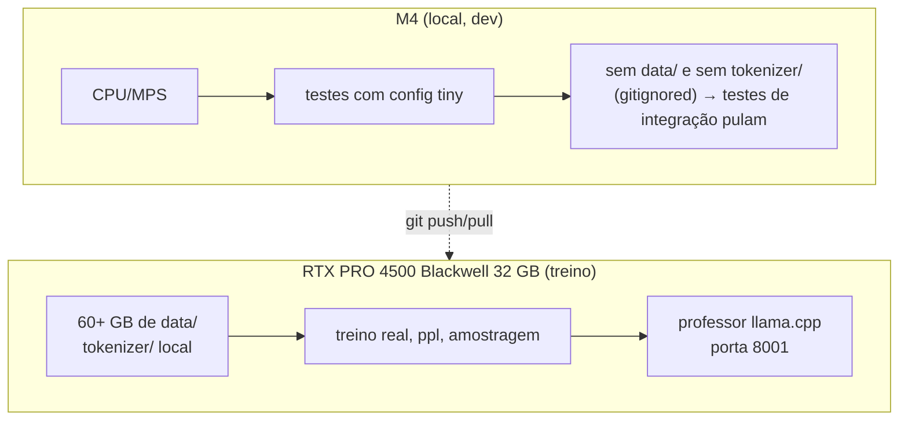

# Infra e GPU

## Software

| Item | Versão / escolha | Por quê |
|---|---|---|
| Gerenciador | **`uv`** (pyproject + `uv run`) | venv/lock reproduzíveis, ~1 comando por script; `uv.lock` **versionado** |
| Python | 3.12+ (`.python-version`) | exigência do `pyproject.toml` |
| PyTorch | ≥ 2.15 (build CUDA) | `scaled_dot_product_attention`, `torch.compile`, bf16 |
| Transformers | ≥ 5.22 (**v5**) | só scaffold (`PreTrainedModel`, `PretrainedConfig`) |
| Tokenizers | ≥ 0.23 | BPE byte-level |
| Dados | `pyarrow`, `zstandard`, `datasets`, `huggingface_hub` | parquet + `.zst` + Hub |
| Testes | `pytest` (grupo `dev`) | 103 testes, todos rodáveis em CPU |

> [!warning] `requests` **não** está instalado
> Todo HTTP (professor, OpenRouter, download) usa `urllib.request`. Não adicionar dependência
> só para isso.

## Duas máquinas



- **Dados e tokenizer só existem na RTX** (`data/` ≈ 69 GB: 40 GB de `.jsonl.zst` + 23 GB de
  parquet + 5,7 GB de tokens). Na M4 os testes de integração se **auto-pulam**.
- Login HF já feito na RTX (`marcelogsouza`) e o gate do Community OSCAR já aceito.

## A GPU é disputada — regra de ouro

> [!danger] Antes de qualquer coisa em CUDA: **avisar o usuário**
> A RTX foi também o servidor de inferência de uso diário (o **Strata**, ~31,4 GB de VRAM e
> ~52 GB de RAM). Se `nvidia-smi` mostra ~31 GB usados, o Strata está de pé e **não há VRAM**
> para treinar. O fluxo combinado: o usuário troca o Opencode para um modelo na nuvem, derruba
> o Strata, e só então roda-se treino/benchmark.

Checagem rápida:

```bash
nvidia-smi --query-gpu=memory.used,memory.total,utilization.gpu,temperature.gpu \
           --format=csv
```

| Situação lida no `nvidia-smi` | Interpretação |
|---|---|
| ~31 GB usados | Strata de pé → **não use CUDA** |
| ~5 GB usados + ~85% util | professor llama.cpp servindo (`gen_sft.py` no ar) |
| ~19 GB usados + 100% util | treino do Pingo rodando |
| ~0 GB | GPU livre |

## O que a GPU aguenta (medido, não estimado)

| Grandeza | Valor medido |
|---|---|
| VRAM total | 32.623 MiB |
| Pré-treino sem `--compile` (B16 × accum16) | **28.531 MiB** (≈ 4 GB livres) |
| Pré-treino com `--compile` (B16 × accum16) | **18,8 GiB** |
| Pré-treino com `--compile` (B12) | 14,5 GiB |
| B=32 sem compile | **não cabe** |
| Temperatura durante o run | 84–86 °C, sem throttle |
| Throughput | 55k tok/s (eager) → **101k tok/s** (`--compile`) |
| Memória do KV cache (B=16, ctx 2048, bf16) | ≈ 1,31 GiB ([[KV cache]]) |

Números completos e o método em [[Benchmarks na GPU]].

## RAM é apertada

O OOM mais provável neste projeto **não** é de VRAM, é de RAM: com o Strata segurando ~52 GB
dos ~62 GB, qualquer pipeline de dados precisa processar **por row group** e nunca carregar um
parquet inteiro. O treino do tokenizer picou 3 GB de pico fazendo exatamente isso
([[Tokenizer BPE byte-level]]).

## Disco

| Diretório | Tamanho | Apagável? |
|---|---|---|
| `data/2024-10/` (100 `.jsonl.zst`) | 40 GB | ✅ sim — tudo já está tokenizado e é re-baixável |
| `data/raw/` (parquet filtrado) | 23 GB | ⚠️ é a **fonte** do SFT ([[Geração do dataset]]) |
| `data/tokens/` (`.bin` uint16) | 5,7 GB | ❌ é isso que o treino lê |
| `runs/pt-120m/` | 4,8 GB | ❌ + backup read-only |
| `runs/pt-120m-BACKUP-2026-10-30/` | 4,8 GB | ❌ **nunca** |

Um `ckpt.pt` do pré-treino ≈ 1,5 GB (pesos + estado do otimizador).

## O professor (llama.cpp)

- Build **b11669**, modelo `unsloth/Qwen3.5-4B-GGUF:UD-Q4_K_XL`, **8 slots**, ctx **4096 por
  slot**, porta **8001**, ~5 GB de VRAM.
- ~85% da GPU enquanto gera; **160–175 tok/s agregados** de completion.
- O servidor **não é subido por nós** (o script de serving mora em `~/llm_serving_scripts/`,
  fora do repo). Ver [[O professor local]].

## Ver também

- [[Benchmarks na GPU]] — os números por extenso
- [[O professor local]] — o outro ocupante da GPU
- [[Gotchas]] — limites e armadilhas de ambiente
- [[Pingo]] — voltar ao índice
