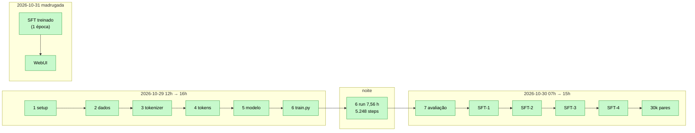

# Linha do tempo

A história real do projeto, reconstruída a partir do `git log`. **31 commits entre 2026-10-29
11h58 e 2026-10-30 23h55** — o projeto inteiro (dados → pré-treino → dataset de SFT) levou ~36
horas de parede, sendo ~7,6 h de treino de GPU e ~12 h de geração do dataset no professor local.

> [!note] Como ler os hashes
> Os hashes são os do `main` nesta máquina. `docs:` = atualização do estado (`AGENTS.md`/
> `README.md`); `step N:` = um passo do `PLAN.md`; `sft-N:` = uma etapa do pipeline de SFT.

## Dia 1 — 2026-10-29: da ideia ao modelo treinado

| Hora | Commit | O que aconteceu |
|---|---|---|
| 11:58 | `bfc73b2` | **Initial commit**: `PLAN.md` — LLM pt-BR do zero, Fase 1 = pré-treino 120M |
| 12:00 | `f69f863` | README com apresentação, arquitetura e roadmap |
| 12:02 | `d81ec09` | logo do Pingo no repositório |
| 12:13 | `fedea61` | **Passo 1**: `uv init`, deps, estrutura, pytest |
| 12:32 | `cd03926` | **Passo 2**: scripts do OSCAR (`download_data.py` retomável + `process_data.py`) |
| 13:20 | `0b3557e` | proveniência dos dados no README + wrappers `.sh`/`.bat` |
| 13:25 | `0e585bc` | `AGENTS.md` nasce (estado/handoff) |
| 13:31 | `b7ecff0` | download `2024-10` completo |
| 14:07 | `24715bd` | **Passo 2 completo**: 10,7M docs, 59,7B chars |
| 14:25 | `074ce6a` | nota sobre auth HF na máquina RTX |
| 14:35 | `f0e882a` | **Passo 3**: tokenizer BPE byte-level 16.384 (4,091 chars/token) |
| 15:03 | `7b987d4` | **Passo 4**: binarização — 2,75B tokens train + 292M val |
| 15:14 | `fdc2148` | contagem exata de params (127,6M), disco 69 GB |
| 15:31 | `6e29f62` | **Passo 5**: modelo + `PingoCache` + `generate`; 26 testes verdes |
| 15:45 | `175143f` | **Passo 6 (parcial)**: `train.py` com decay-groups, cosine, resume bit-exato |
| 15:50 | `812287a` | `AGENTS.md` vira playbook autocontido p/ sessão nova |
| 16:19 | `8234a64` | **benchmark real na GPU** + correção do `--compile` (prefixo `_orig_mod.`) |

## Noite 1 → Dia 2 — o run de verdade

- **2026-10-29 ~16h30 → 2026-10-30 00h30**: pré-treino em `runs/pt-120m`, **5.248 steps**,
  **7,56 h**, `--compile` ligado, ~101k tok/s, VRAM 18,8 GiB. Val 9,69 (init) → 2,507.
  Detalhes e curva em [[Run do Pingo-120M]].

| Hora | Commit | O que aconteceu |
|---|---|---|
| 07:09 | `dfc5cd6` | **Passo 6 fechado**: val 2,507 / ppl 12,3 |
| 07:31 | `ab5167c` | **Passo 7**: ppl 11,67, `repetition_penalty`, bench do KV cache (10,6×/11,8×) |
| 09:47 | `f007091` | **mudança de rumo**: 350M suspenso, próximo é SFT |
| 10:33 | `c66ccfd` | **SFT-1**: gerador do dataset (professor Qwen3.5-4B local, 21 testes) |
| 12:08 | `24a013e` | **SFT-2**: validador (revalidação, MinHash/LSH, split por doc) |
| 12:23 | `5335b78` | **SFT-3**: treino de instrução (tokens de chat, `attention_mask`, loss só na resposta) |
| 12:37 | `f0f7c67` | **SFT-4**: avaliação (formato, fidelidade, esquecimento) |
| 12:47 | `841af8c` | juiz de recusas no validador (uma 2ª opinião do professor) |
| 14:31 | `ac9132c` | comparação de professores remotos (OpenRouter) + script de piloto |
| 14:33 | `0680744` | gotcha do `--resume` no contador do `tqdm` |
| 15:12 | `6a12418` | **vault `docs/`**: 38 notas (Obsidian) — a documentação explicativa do projeto |
| 23:50 | `36164cb` | **dataset de SFT completo**: 30.000 pares em `data/sft/sft-v1.jsonl` (11h51 de retomada, 37,8 pares/min) |

## Madrugada — 2026-10-31: o SFT roda

| Hora | Commit | O que aconteceu |
|---|---|---|
| 00:02 | — | **SFT v1** (3 épocas, lr 1e-4): 2.484 steps em 13 min. Val mínimo no step 200 e **6,94× de esquecimento** — overfit |
| 00:09 | — | **SFT v2** (1 época, lr 5e-5): 828 steps em 4min52s, val 1,76, fator **1,91×** |
| 00:11 | — | avaliação: formato 100%, F1 0,375, fidelidade 0,59 ([[Run do SFT-120M]]) |
| 00:40 | `670b906` | **WebUI em Flask**: chat com streaming SSE, SFT + base, contexto opcional ([[WebUI]]) |

## Como o dia 2 terminou

O dataset de SFT fechou às 23h43 (30.000 pares, [[Geração do dataset]]) e a madrugada foi de
treino: 13 min do run de 3 épocas, 4min52s do de 1 época, 24 s de avaliação e a WebUI em Flask
([[Run do SFT-120M]], [[WebUI]]). Os três primeiros dias do projeto couberam em ~40 h de
parede — com a maior parte delas gasta em geração de dados, não em GPU.

## Lições de processo que o `git log` mostra

1. **Commits pequenos e temáticos** (`step N`, `docs:`) fizeram o handoff funcionar: uma
   sessão nova lia `AGENTS.md` + `git log` e retomava sem contexto prévio.
2. **A documentação de estado veio antes da documentação explicativa.** `AGENTS.md` foi
   escrito no meio do Passo 2; este vault só apareceu depois da Fase 1 fechada — quando já
   havia números reais para documentar.
3. **Os bugs mais caros têm commit próprio** (o `--compile` quebrando o no-decay; o `labels`
   deslocado do SFT-3) e viraram teste.

## Ver também

- [[Decisões (ADR)]] — o *porquê* de cada virada
- [[Run do Pingo-120M]] — a noite de treino em detalhe
- [[Pingo]] — voltar ao índice
