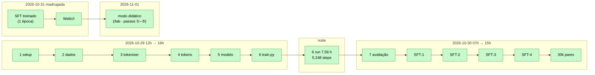

# Linha do tempo

A história real do projeto, reconstruída a partir do `git log`. **31 commits entre 2026-10-29
11h58 e 2026-10-30 23h55** — o projeto inteiro (dados → pré-treino → dataset de SFT) levou ~36
horas de parede, sendo ~7,6 h de treino de GPU e ~12 h de geração do dataset no professor local.

> [!note] Como ler os hashes
> Os hashes são os do `main` nesta máquina. `docs:` = atualização do estado (`AGENTS.md`/
> `README.md`); `step N:` = um passo do `PLAN.md`; `sft-N:` = uma etapa do pipeline de SFT.

## Dia 1 — 2026-10-29: da ideia ao modelo treinado

| Hora | Commit | O que aconteceu |
|---|---|---|
| 11:58 | `bfc73b2` | **Initial commit**: `PLAN.md` — LLM pt-BR do zero, Fase 1 = pré-treino 120M |
| 12:00 | `f69f863` | README com apresentação, arquitetura e roadmap |
| 12:02 | `d81ec09` | logo do Pingo no repositório |
| 12:13 | `fedea61` | **Passo 1**: `uv init`, deps, estrutura, pytest |
| 12:32 | `cd03926` | **Passo 2**: scripts do OSCAR (`download_data.py` retomável + `process_data.py`) |
| 13:20 | `0b3557e` | proveniência dos dados no README + wrappers `.sh`/`.bat` |
| 13:25 | `0e585bc` | `AGENTS.md` nasce (estado/handoff) |
| 13:31 | `b7ecff0` | download `2024-10` completo |
| 14:07 | `24715bd` | **Passo 2 completo**: 10,7M docs, 59,7B chars |
| 14:25 | `074ce6a` | nota sobre auth HF na máquina RTX |
| 14:35 | `f0e882a` | **Passo 3**: tokenizer BPE byte-level 16.384 (4,091 chars/token) |
| 15:03 | `7b987d4` | **Passo 4**: binarização — 2,75B tokens train + 292M val |
| 15:14 | `fdc2148` | contagem exata de params (127,6M), disco 69 GB |
| 15:31 | `6e29f62` | **Passo 5**: modelo + `PingoCache` + `generate`; 26 testes verdes |
| 15:45 | `175143f` | **Passo 6 (parcial)**: `train.py` com decay-groups, cosine, resume bit-exato |
| 15:50 | `812287a` | `AGENTS.md` vira playbook autocontido p/ sessão nova |
| 16:19 | `8234a64` | **benchmark real na GPU** + correção do `--compile` (prefixo `_orig_mod.`) |

## Noite 1 → Dia 2 — o run de verdade

- **2026-10-29 ~16h30 → 2026-10-30 00h30**: pré-treino em `runs/pt-120m`, **5.248 steps**,
  **7,56 h**, `--compile` ligado, ~101k tok/s, VRAM 18,8 GiB. Val 9,69 (init) → 2,507.
  Detalhes e curva em [[Run do Pingo-120M]].

| Hora | Commit | O que aconteceu |
|---|---|---|
| 07:09 | `dfc5cd6` | **Passo 6 fechado**: val 2,507 / ppl 12,3 |
| 07:31 | `ab5167c` | **Passo 7**: ppl 11,67, `repetition_penalty`, bench do KV cache (10,6×/11,8×) |
| 09:47 | `f007091` | **mudança de rumo**: 350M suspenso, próximo é SFT |
| 10:33 | `c66ccfd` | **SFT-1**: gerador do dataset (professor Qwen3.5-4B local, 21 testes) |
| 12:08 | `24a013e` | **SFT-2**: validador (revalidação, MinHash/LSH, split por doc) |
| 12:23 | `5335b78` | **SFT-3**: treino de instrução (tokens de chat, `attention_mask`, loss só na resposta) |
| 12:37 | `f0f7c67` | **SFT-4**: avaliação (formato, fidelidade, esquecimento) |
| 12:47 | `841af8c` | juiz de recusas no validador (uma 2ª opinião do professor) |
| 14:31 | `ac9132c` | comparação de professores remotos (OpenRouter) + script de piloto |
| 14:33 | `0680744` | gotcha do `--resume` no contador do `tqdm` |
| 15:12 | `6a12418` | **vault `docs/`**: 38 notas (Obsidian) — a documentação explicativa do projeto |
| 23:50 | `36164cb` | **dataset de SFT completo**: 30.000 pares em `data/sft/sft-v1.jsonl` (11h51 de retomada, 37,8 pares/min) |

## Madrugada — 2026-10-31: o SFT roda

| Hora | Commit | O que aconteceu |
|---|---|---|
| 00:02 | — | **SFT v1** (3 épocas, lr 1e-4): 2.484 steps em 13 min. Val mínimo no step 200 e **6,94× de esquecimento** — overfit |
| 00:09 | — | **SFT v2** (1 época, lr 5e-5): 828 steps em 4min52s, val 1,76, fator **1,91×** |
| 00:11 | — | avaliação: formato 100%, F1 0,375, fidelidade 0,59 ([[Run do SFT-120M]]) |
| 00:40 | `670b906` | **WebUI em Flask**: chat com streaming SSE, SFT + base, contexto opcional ([[WebUI]]) |
| 06:40 | `c4389c7` | WebUI ouve em `0.0.0.0` (LAN) por padrão e avisa que não há autenticação |

## 2026-11-01: o Pingo vira aula

| Hora | Commit | O que aconteceu |
|---|---|---|
| 12:06 | `f0c8899` | **Modo didático** em `/lab`: tokenização colorida (id, superfície byte-level, bytes), ficha do token com a faixa dos 896 números e os vizinhos por cosseno, busca no vocab ([[Modo didático]]) |
| 12:07 | `e9e4352` | nota nova no vault + estado (índice, grafo, linha do tempo, 6 gotchas) |
| 12:20 | `9402fe9` | o lab passa a envolver o texto **só** com `<\|user\|>…<\|assistant\|>` (sem o `Pergunta:` do dataset) — revelou que `Quanto` (6.666) e `ĠQuanto` (8.579) são tokens diferentes: o espaço faz parte do token |
| — | — | A tabela de embeddings passou a ser lida **direto do `model.safetensors` na CPU** (58 MB) — o lab roda sem encostar na VRAM do professor |
| — | — | Suíte: **141 casos** em 12 arquivos (`pingo/didatic.py` novo, +13; WebUI 23) |
| — | `0baf82a` | **Modo didático passo ② (embedding)**: o stepper virou abas; a frase vira uma **matriz desenhada** (faixa por token preservando o maior módulo), a tabela inteira vira **histograma de normas** — e as três menores dos 16.387 vetores são exatamente os tokens de chat (0,235/0,236/0,382) — e a tabela é **lida de volta** (`v·W`, tied): nota e cosseno ordenam diferente porque a nota inclui a norma; `<|assistant|>` lido pela nota é lixo mas em cosseno o nº 1 é `<|user|>` com 0,986 ([[Modo didático]]) |
| — | — | Suíte: **149 casos** em 12 arquivos (+4 `test_didatic`, +4 `test_webui`) |
| — | `f3be8f5` | **Modo didático passo ③ (RoPE + atenção)**: `capture` no forward (sem captura, bit a bit idêntico — teste), relógio do RoPE com os 32 ponteiros de um Q real + ponto verde de conferência, radar do token por cabeça, matriz n×n com a máscara causal visível; as primeiras rotas do lab que carregam o modelo (gen_lock, 64 tokens, 0,66 s de forward na CPU) — Q/K conferidos no checkpoint: ‖q_lin‖=‖q‖ e o par 0 batendo 4 decimais; repetido na GPU depois que o Strata saiu (0,64 s com o load, 0,004 s com a captura em cache, valores idênticos aos da CPU) ([[Modo didático]]) |
| — | — | Suíte: **156 casos** em 12 arquivos (+4 `test_model` de capture, +3 rotas do ③) |
| — | `1fb5fc0` | **Modo didático passo ④ (RMSNorm + SwiGLU)**: a carona do ④ **estende, não bifurca** — o `capture` ganha o bloco inteiro (`x0/n1p/n1/a/x1/n2p/n2/g/u/s/m/x2` + os γ), preenchido na passagem real sem duplicar a conta (logits seguem bit a bit idênticos; `x2[k] == x0[k+1]` e ‖RMSNorm puro‖ = √d são testes). Rota `/api/lab/bloco` e três cards: a **régua** (‖x‖ → RMS puro → com γ → Δ da camada), o **γ desenhado** (faixa alternável attn/MLP) e o **SwiGLU** (gate/up/produto na mesma escala + portas abertas). **Um único forward serve ③ e ④**: trocar camada custa 12 ms. Números no SFT: RMS puro 29,92 p/ todos — chat 29,69 (o piso do ε); γ da camada 1 quase unânime (0,86–0,93); resíduo cresce **100×** até a camada 12; `Ġinvestir` abre **151 de 2.304** portas ([[Modo didático]]) |
| — | — | Suíte: **163 casos** em 12 arquivos (+1 `test_model` do bloco, +3 `test_didatic` da ficha do bloco, +3 `test_webui` da rota — incluindo *a captura do ③ serve o ④*) |
| — | `5befef1` | `scripts/webui.sh`: levanta a WebUI em foreground com **Ctrl+C desligando tudo** (e derruba a instância anterior na 8010); conferido de ponta a ponta antes do teste na GPU livre |
| — | `25d9d7b` | **Modo didático passo ⑤ (lm head)**: a última carona — o **último** dict do `capture` ganhou `nfinp/nfin` (a norm final antes/depois do γ, pelas mãos do próprio `RMSNorm`) e o `Server` passou a guardar os **logits do próprio forward** (`out.logits` `[64×16.387]` ≈ 4 MB): nada é recomputado. Rota `/api/lab/lmhead` + quatro cards: a **última régua** (‖x₂‖ 28,8–57,7 → **29,93 para todos** — sem o piso do ε, nenhum vetor é pequeno depois de 12 camadas → 46–48 com γ), o **γ final desenhado** (média **1,61**, σ 0,06 — o botão de volume do produto escalar), a **régua dos 16.387 logits** com top-10 e o **posto do sucessor real** (`investir → até`: **5º de 16.387**, o favorito era `ĠR` — o fantasma do R$) e **a mesma tabela lida duas vezes** (prévia ② × logit ⑤). O **tie provado bit a bit**: recomputar `nfin @ tabelaᵀ` com o `safetensors` na CPU bate com os logits do forward (**maxdiff 0,0**) — virou teste ([[Modo didático]]) |
| — | — | Suíte: **169 casos** em 12 arquivos (+1 `test_model` do tied/norm final, +2 `test_didatic` da ficha do lm head, +3 `test_webui` da rota — a captura do ③ agora serve ③, ④ **e** ⑤; 16 ms por posição nova na CPU) |

Cinco dos sete passos de uma esteira (tokenização → embedding → RoPE/atenção → MLP → lm
head → amostragem → loop). O objetivo deixou de ser só "ter um modelo": passou a ser **mostrar
o modelo por dentro**, que é o que o projeto sempre prometeu ser ([[Visão e filosofia]]).

## Como o dia 2 terminou

O dataset de SFT fechou às 23h43 (30.000 pares, [[Geração do dataset]]) e a madrugada foi de
treino: 13 min do run de 3 épocas, 4min52s do de 1 época, 24 s de avaliação e a WebUI em Flask
([[Run do SFT-120M]], [[WebUI]]). Os três primeiros dias do projeto couberam em ~40 h de
parede — com a maior parte delas gasta em geração de dados, não em GPU.

## Lições de processo que o `git log` mostra

1. **Commits pequenos e temáticos** (`step N`, `docs:`) fizeram o handoff funcionar: uma
   sessão nova lia `AGENTS.md` + `git log` e retomava sem contexto prévio.
2. **A documentação de estado veio antes da documentação explicativa.** `AGENTS.md` foi
   escrito no meio do Passo 2; este vault só apareceu depois da Fase 1 fechada — quando já
   havia números reais para documentar.
3. **Os bugs mais caros têm commit próprio** (o `--compile` quebrando o no-decay; o `labels`
   deslocado do SFT-3) e viraram teste.

## Ver também

- [[Decisões (ADR)]] — o *porquê* de cada virada
- [[Run do Pingo-120M]] — a noite de treino em detalhe
- [[Pingo]] — voltar ao índice
