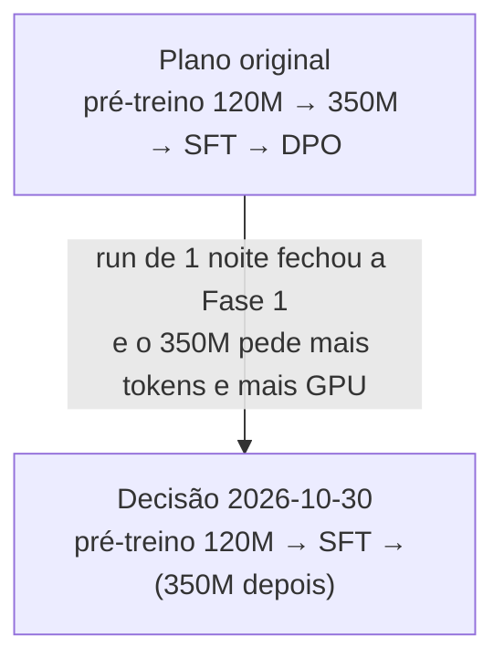

# Visão e filosofia

> [!abstract] Em uma frase
> Construir uma LLM de verdade — **arquitetura própria em PyTorch**, corpus próprio, tokenizer
> próprio — em português, com cada decisão entendida e cada número medido, e não apenas
> "chamar um modelo pronto e fazer fine-tuning".

## O que o Pingo é

- Um **projeto-curso**: o objetivo é aprender (e documentar) o ciclo completo de uma LLM.
- Um modelo **decoder-only** escrito à mão: `RMSNorm`, `RoPE`, atenção causal com
  `F.scaled_dot_product_attention`, `SwiGLU`, embeddings *tied* — ver
  [[Arquitetura do Pingo]].
- **Zero** `GPT2LMHeadModel`, **zero** `LlamaForCausalLM`. O Hugging Face Transformers entra
  apenas como *scaffolding*: `PingoLM(PreTrainedModel)` herda de `PreTrainedModel` só para
  ganhar `save_pretrained`, `from_pretrained` e o formato de `config.json` que o Hub entende.
- Treinado **do zero** (random init) no corpus que nós mesmos baixamos e filtramos
  ([[Escolha do dataset]]).

## O que o Pingo não é

| Não é | Por quê |
|---|---|
| um modelo "útil" de uso geral | 127M de parâmetros com 2,75B tokens é um exercício; não compete com GPT/Claude |
| um fork de receita pronta | nada de copiar `modeling_llama.py`; só a matemática publicada é referência |
| um projeto de serving | a inferência existe para **medir** o modelo (ppl, amostras, KV cache) |
| RLHF (ainda) | DPO está no roadmap (item 10), depois do SFT |

## As três regras que guiam o projeto

1. **Tudo é medido, nada é "achismo".**
   Exemplos: a compressão do tokenizer é comparada com o GPT-2 no *mesmo* texto de val
   ([[Métricas de compressão]]); o KV cache é validado por equivalência de logits `< 1e-5`
   ([[KV cache]]); o `--resume` é testado por **bit-exatidão** dos pesos
   ([[Checkpoints e resume]]).
2. **Cada etapa é um entregável verificável.**
   O `PLAN.md` diz, para cada passo, um "✔ Critério". O passo só fecha quando o critério é
   atingido e há teste automatizado cobrindo ([[Suíte de testes]]).
3. **O erro vira documentação.**
   Cada pegadinha encontrada é registrada ([[Gotchas]]) e, quando dá, transformada em teste.
   O vault só tem graça se contar o que deu errado também.

## A restrição que moldou tudo

A máquina de treino é uma **RTX PRO 4500 (Blackwell, 32 GB)** que **também roda o servidor de
inferência do dia a dia** (o "Strata", ~31 GB de VRAM). Duas consequências:

- **Sem run contínuo de 3 dias** (restrição explícita do usuário) → o treino tem de caber em
  uma noite e ser **fatiável**: checkpoints a cada 15 min + `--resume` bit-exato. Isso mudou
  o escopo do modelo: em vez de um 350M já de cara, o **Pingo-120M** ([[Linha do tempo]]).
- **A GPU é um recurso disputado** → a regra: nunca iniciar trabalho em CUDA sem avisar. O
  usuário derruba o Strata e troca o Opencode para um modelo na nuvem quando vamos treinar
  ([[Infra e GPU]]).

## O rumo mudou no meio (e está documentado)

O plano original era: pré-treino → escalar para 350M → SFT → DPO. Em **2026-10-30**, logo
depois de fechar a Fase 1, o usuário decidiu **suspender o 350M** e ir direto para o **SFT**,
com o dataset gerado sinteticamente por um **professor local** que lê o próprio corpus do
pré-treino. O motivo e as consequências estão em [[Por que SFT]] e [[Decisões (ADR)]].

## Ver também

- [[Linha do tempo]] — como isso aconteceu, na prática
- [[Infra e GPU]] — o hardware e as limitações
- [[Comandos e cheatsheet]] — como reproduzir
- [[Pingo]] — voltar ao índice
