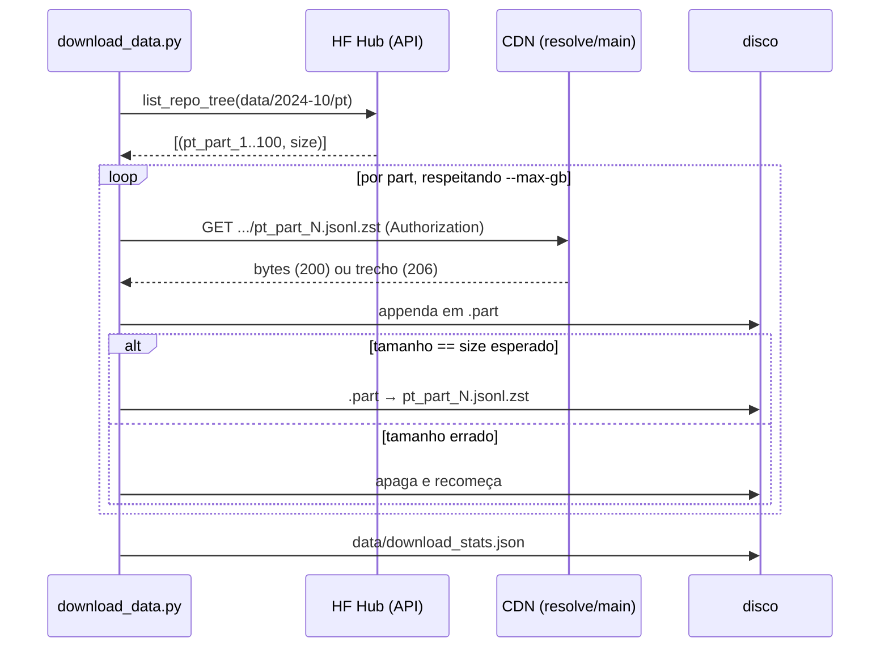

# Download do OSCAR

Script: `scripts/download_data.py` (wrappers `scripts/download_data.sh` e `.bat`).

> [!abstract] Resultado
> **100 parts** de `2024-10/pt` → **42,7 GB** em `data/2024-10/pt/` (≈ 1 h com 4 threads,
> ~11,7 MB/s médios). O dump reserva `2023-40` não foi necessário.

## Pré-requisitos (só uma vez)

```bash
uv run hf auth login      # token da conta HF
```
E aceitar o **gate** do dataset na página dele no Hub. O Community OSCAR usa **gate
automático**: aceitar os termos libera o acesso na hora (não há aprovação manual). Sem token,
ou sem o gate aceito, o CDN responde **401**.

## Como o script funciona



Pontos que fazem a diferença:

1. **Orçamento em GB** (`--max-gb 45`): partes já locais *não* consomem orçamento novo, então o
   script é idempotente e pode ser re-executado sem baixar de novo.
2. **Retomada por HTTP Range**: se existe `pt_part_N.jsonl.zst.part`, manda
   `Range: bytes=<tamanho>-` e continua de onde parou. Fundamental num CDN que derruba conexão.
3. **Verificação por tamanho**: a única checagem de integridade é `st_size == size` vindo do
   Hub. Se bater, `.part` é renomeado (`.part` só existe enquanto está incompleto → a ausência
   do `.part` é o "selo" de completo).
4. **Retry com backoff exponencial**: `wait = 2**attempt` segundos, 5 tentativas, e na última
   falha o erro sobe.
5. **Paralelismo** com `ThreadPoolExecutor(4)` — é I/O, não CPU.

## Argumentos

| Arg | Default | Para que serve |
|---|---|---|
| `--dumps` | `2024-10` | aceita vários; o orçamento é global |
| `--max-gb` | 45.0 | teto de download (o plano pede ~40–50 GB) |
| `--workers` | 4 | downloads simultâneos |
| `--retries` | 5 | tentativas por part |
| `--dry-run` | — | só imprime o plano |
| `--out` | `data/` | raiz onde `data/<dump>/pt/...` é montado |

> [!note] Cuidado com path duplicado
> Os caminhos **do repositório HF já começam com `data/`**
> (`data/2024-10/pt/pt_part_7.jsonl.zst`). Por isso o destino é
> `args.out / path.removeprefix("data/")`. Compor `data/` + caminho cru geraria
> `data/data/2024-10/...`.

## O que ficou registrado

`data/download_stats.json` guarda o **último** run:

```json
{"repo": "oscar-corpus/community-oscar", "dumps": ["2024-10"],
 "parts": 100, "bytes_baixados_essa_execucao": 0, "segundos": 3640.3}
```

`bytes_baixados_essa_execucao: 0` é literalmente o certo: essa foi uma **segunda** execução,
que encontrou tudo no lugar e não baixou nada — a prova de que a lógica de "já local → pula" e
de que registrar só o *delta* da execução funciona.

## Verificação manual

```bash
ls data/2024-10/pt/pt_part_*.jsonl.zst | wc -l        # 100
find data/2024-10 -name '*.part' | wc -l              # 0 (nada incompleto)
du -sh data/2024-10                                   # ~40G em disco (42,7 GB decimais)
```

## Ver também

- [[Escolha do dataset]] — por que esse dump
- [[Filtro de qualidade]] — o passo seguinte
- [[Comandos e cheatsheet]] — a sequência completa
- [[Pingo]] — voltar ao índice
