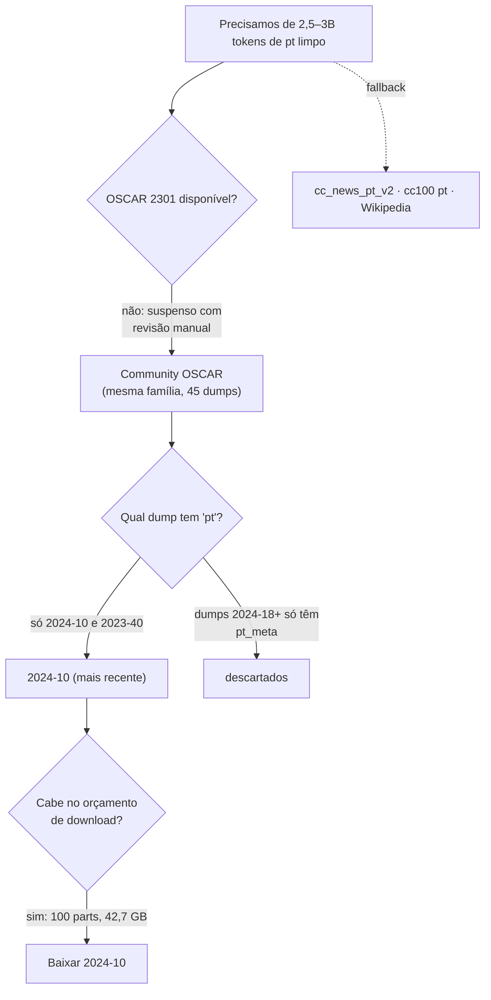

# Escolha do dataset

> [!abstract] Resumo
> `oscar-corpus/community-oscar`, idioma **`pt`**, dump **`2024-10`**, 100 shards
> `.jsonl.zst` (~42,7 GB). Gate automático no HF. É o único caminho prático hoje: o OSCAR-2301
> clássico está suspenso e os dumps novos só publicam metadados de `pt`.

## O processo de escolha



## O que entrou e o que ficou de fora

| Candidato | Por que não |
|---|---|
| **OSCAR 2301** (o clássico) | suspenso com revisão manual — não é mais servido |
| `eduagarcia/cc_news_pt_v2` | só notícia: domínio estreito demais e viés de estilo jornalístico |
| `statmt/cc100` `pt` | crawl antigo (2018-ish), sem atualização |
| Wikipedia pt | ótimo para qualidade, mas ~1B de palavras no total: não sustenta 2,75B tokens sozinho |
| Dumps `2024-18`+ do Community OSCAR | publicam só `pt_meta` — **não há texto** |

## Como o Community OSCAR é organizado

```
data/<dump>/<idioma>/<idioma>_part_<N>.jsonl.zst
ex.: data/2024-10/pt/pt_part_37.jsonl.zst
```

Cada linha é um JSON com:

```json
{
  "id": "...",
  "content": "texto extraído da página",
  "warc_headers": {"warc-target-uri": "https://exemplo.com/pagina"},
  "metadata": {"identification": {"language": ...}}
}
```

> [!tip] Shards independentes = download paralelizável e retomável
> Isso permitiu baixar em 4 threads, retomar por HTTP Range e **parar** quando o orçamento de
> GB acabou ([[Download do OSCAR]]).

> [!warning] `pt_part_N` não tem tamanho uniforme
> Muitas parts têm ~10 MB em vez de ~427 MB. Validar pelo **tamanho real** que o Hub reporta,
> nunca por uma média assumida — senão um download truncado passa como completo.

## O tamanho do dump e a decisão de não usar o reserva

| Dump | Parts | Tamanho | Uso |
|---|---|---|---|
| **`2024-10`** | 100 | ~42,7 GB | ✅ usado |
| `2023-40` | 68 | ~41,8 GB | reserva (não foi preciso) |

O plano previa um reserva caso a tokenização não chegasse a 2,5B tokens. Depois do filtro
sobraram **59,7B caracteres ≈ ~15B tokens** — **6× a meta** — então o reserva nunca foi
baixado. Isso é a origem da decisão de **amostrar** 2,75B tokens ([[Binarização e shards]]).

## O preço de usar web cru

O Community OSCAR é *Common Crawl filtrado por idioma*, não filtrado por qualidade. Resultado
honesto, medido no filtro local ([[Filtro de qualidade]]):

- só **55,6%** dos documentos passam no filtro mínimo;
- ~1,9M documentos eram **duplicatas exatas** (espelhos republicando o mesmo texto);
- cassino/SEO/spam adulto **passam** por serem texto legível — herança que só aparece de
  verdade no `split=val` (ppl inflada) e, depois, ao gerar o dataset de SFT
  ([[Geração do dataset]]).

> [!bug] Consequência direta no SFT
> O que é "ruído tolerável" no pré-treino (o modelo só precisa aprender estatística de texto)
> é **veneno** no SFT (o modelo aprenderia a *responder* sobre o cassino). Por isso o filtro
> do SFT é bem mais duro, com blocklist de URL.

## Variantes do português

Decisão: **não** separar pt-BR de pt-PT. O português brasileiro domina o web-pt; filtrar
variante exigiria um classificador (mais código, mais erro) para ganhar pouco. As amostras de
[[Perplexidade e KV cache]] mostram "está a ser implementado" — flagrante aceito e documentado.

## Ver também

- [[Download do OSCAR]] — como os 42,7 GB chegaram ao disco
- [[Filtro de qualidade]] — o que foi feito com eles
- [[Decisões (ADR)]] — ADR-03 e ADR-04
- [[Pingo]] — voltar ao índice
