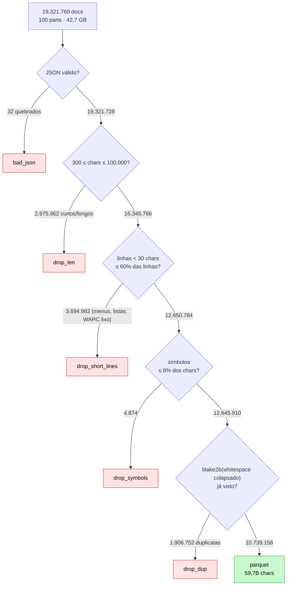

# Filtro de qualidade (Passo 2)

Script: `scripts/process_data.py` → parquet em `data/raw/`, contagens em `data/raw/stats.json`.

> [!abstract] Resultado
> **19.321.760** docs lidos → **10.739.158** aprovados (**55,6%**) → **59.737.711.111**
> caracteres (≈ 14,9B tokens pela régua de 4 chars/token) em **23 GB** de parquet. 1,9M
> duplicatas exatas removidas.

## O funil, com números medidos



O balanço fecha exatamente:

$$
\underbrace{10\,739\,158}_{\text{kept}} + 2\,975\,962 + 3\,694\,982 + 4\,874 + 1\,906\,752 +
32 = 19\,321\,760
$$

E o aproveitamento é

$$
\text{aproveitamento} = \frac{10\,739\,158}{19\,321\,760} = 0{,}5558 .
$$

> [!note] Leitura honesta dos números
> - **Comprimento** é o filtro que mais corta (15,4%).
> - **Linhas curtas** corta ainda mais (19,1%) — é o clássico "página que é só menu/lista".
> - **Símbolos** é praticamente **inerte** (0,025%): o limiar de 8% é frouxo de propósito
>   (texto técnico com tabelas tem bastante `#<>|`), mas na prática quase nada é barrado por
>   ele. Serviria mais num corpus de código.
> - **Dedup** tira 9,9% — percentual altíssimo, típico de espelhos e sites de notícia que
>   republicam o mesmo release.

## Os filtros, um por um

```python
def passes(content, args):
    n = len(content)
    if n < args.min_chars or n > args.max_chars:            # 300 .. 100_000
        return False, "len"
    lines = content.split("\n")
    if sum(len(ln.strip()) < 30 for ln in lines) > 0.6 * len(lines):
        return False, "short_lines"                          # short_line_ratio = 0.6
    nsym = sum(content.count(c) for c in "#%&<>=|\\{}[]*~^_=+")
    if nsym > 0.08 * n:
        return False, "symbols"                              # symbol_ratio = 0.08
    return True, ""
```

| Filtro | Regra | Intenção |
|---|---|---|
| `len` | $300 \le n \le 100\,000$ | fora: fragmentos e páginas-monstro (romances, logs) |
| `short_lines` | fração de linhas com < 30 chars $\le 0{,}6$ | remove menus, listas de links, boilerplate por linha |
| `symbols` | fração de chars em `#%&<>=|\{}[]*~^_+` $\le 0{,}08$ | remove base64, tabelas malucas, "lixo de extração" |

## Dedup exato

A chave é o **hash do texto com whitespace colapsado** — não do texto cru. Assim duas cópias
que só diferem em espaços/quebras de linha contam como a mesma página:

$$
k = \text{blake2b}\big(\texttt{"".join(content.split())}\big)[:8\ \text{bytes}]
$$

Duas propriedades importantes:

1. **64 bits** (`digest_size=8`) é suficiente: para 20M docs, a chance de colisão acidental é
   $\approx \frac{n^2}{2\cdot 2^{64}} \approx 10^{-5}$ — desprezível.
2. A chave hex vira o próprio `id` do documento no parquet. É esse `id` que viaja até o dataset
   de SFT (`doc_id`) e permite o split por documento ([[Validação, dedup e splits]]).

> [!warning] O dedup é **por execução**
> O set `seen` vive em memória. Se o script rodar em duas execuções, documentos repetidos
> entre execuções não são barrados. Aceitável aqui (uma execução só), mas importante saber.

## Split de validação (~2%), determinístico por hash

```python
split = "val" if int.from_bytes(key, "big") % 100 < args.val_pct else "train"   # val_pct = 2
```

Usar o **hash** em vez de posição/ordem tem três vantagens:

- é **reproduzível** (mesmo doc → mesmo split, sempre);
- é **independente do shard** (não há "val só do part 3");
- é **uniforme** por construção ($\Pr[\text{val}] = 2\%$).

Resultado real: 215.042 docs de val (o split inteiro vira régua fixa do pré-treino,
[[Binarização e shards]]).

## I/O em row groups (RAM apertada)

`ParquetWriter` recebe lotes de **50.000 docs** (`--row-group-docs`). Isso importa porque a
máquina tem ~62 GB de RAM com o Strata ocupando ~52 GB: carregar uma part inteira
descomprimida (centenas de MB a GB de texto) daria OOM (`[[Infra e GPU]]`).

## Schema do parquet

| Coluna | Tipo | Observação |
|---|---|---|
| `id` | string | blake2b hex do conteúdo normalizado (chave de dedup) |
| `content` | string | o texto |
| `url` | string | `warc_headers["warc-target-uri"]` (pode ser null) |
| `dump` | string | `2024-10` |
| `part` | int32 | número da part |
| `split` | string | `train` (98%) / `val` (2%) |

Arquivos: `data/raw/2024-10-pt_part_N.parquet`, comprimidos com **zstd**.

## Ver também

- [[Escolha do dataset]] — de onde vêm os 19,3M
- [[Tokenizer BPE byte-level]] — o consumidor do `split=train`
- [[Geração do dataset]] — o SFT tem um filtro **muito** mais duro sobre os mesmos parquets
- [[Pingo]] — voltar ao índice
