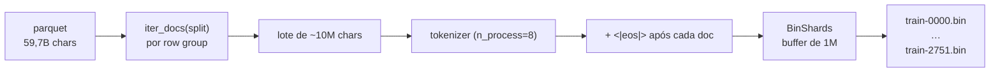

# Binarização e shards

Script: `scripts/prepare_tokens.py` (escreve) + `pingo/data.py` (lê).
Saída: `data/tokens/` — `train-NNNN.bin`, `val-NNNN.bin`, `meta.json`.

> [!abstract] Resultado
> **2.751.379.389** tokens de treino (2.015.381 docs, 12,8 min) em **2.752 shards** de
> 1.000.000 tokens + **291.923.763** tokens de val (215.042 docs, 3,3 min) em **6 shards**.
> ~5,7 GB em disco. Seed 13.

## Por que sair do parquet

Treinar direto do parquet custaria, a cada batch, descomprimir zstd + decodificar UTF-8 +
tokenizar. Fazer isso 5.248 × 16 × 16 vezes = minutos por step. A binarização paga **uma vez**
e depois o treino só faz `memmap` + `copy` de `uint16` — é o truque do nanoGPT.



## Por que `uint16`

O vocabulário é 16.384 < 65.536 = $2^{16}$, então **2 bytes** por token bastam:

$$
\text{disco} = 2{,}75\times10^{9} \times 2\ \text{B} \approx 5{,}5\ \text{GB}
\quad\text{(vs. } 11\ \text{GB com int32)}
$$

Os batches são convertidos para `int64` **só** na hora de ir para a GPU (`torch.from_numpy(...)`
+ `cross_entropy` exige `int64`). O ganho é de banda de memória/disco no carregamento — que,
a 101k tok/s, é justamente um gargalo real.

## Escrita: `BinShards`

```python
class BinShards:
    def add(self, ids):           # enche o buffer, descarrega a cada `cap` tokens
    def _flush(self):             # escreve train-NNNN.bin com EXATAMENTE cap tokens
```

Propriedades:

- cada shard tem **exatamente** 1M tokens (só o último pode ser parcial);
- os tokens de um documento **podem atravessar** a fronteira de shards — o shard é uma divisão
  de *bytes*, não de documentos;
- `<|eos|>` (id 1) vai **depois** de cada documento — é o único separador que o modelo aprende
  a emitir para "fim de texto".

> [!tip] Por que separar docs com `<|eos|>` e não com `<|bos|>`
> O modelo é treinado para prever o próximo token. `<|eos|>` ensina "aqui acaba um texto";
> na geração, ele é o sinal de parada. `<|bos|>` não teria função (não há turnos).

## Tokenização em lote (a diferença de 50×)

`encode_batch()` acumula docs até `--flush-chars 10_000_000` (~10M chars) e chama o tokenizer
**em lote** com `n_process=8`:

| Estratégia | Vazão medida |
|---|---|
| doc por doc (`tok(doc)`) | ~4 MB/s |
| **lote com `n_process=8`** | **~215M tokens/min** |

> [!note] Nada é truncado
> `tok(docs, ...)` sem `truncation` emite um `UserWarning` porque alguns docs passam de
> `model_max_length=2048`. O script **silencia o warning de propósito**: aqui o documento não é
> uma sequência, é fluxo de tokens; o corte em janelas acontece depois, no `get_batch`.

## Leitura: `pingo/data.py`

```python
data = load_tokens(Path("data/tokens"))      # memmap de todos os shards + meta.json
x, y = data.get_batch("train", batch_size=16, ctx=2048, rng=np.random.default_rng(13))
```

O `get_batch` amostra **uniformemente por token**, não por shard:

1. `lens = [len(s) for s in shards]`, `ends = lens.cumsum()`;
2. sorteia `r ~ U[0, ends[-1])` → `i = searchsorted(ends, r)` escolhe o shard
   **proporcionalmente ao tamanho**;
3. sorteia o offset `off ~ U[0, len_i - ctx)`;
4. `x = s[off : off+ctx]`, `y = s[off+1 : off+1+ctx]`.

O deslocamento de 1 é a alma do *next-token prediction*:

$$
x = (t_0, t_1, \dots, t_{T-1}), \qquad
y = (t_1, t_2, \dots, t_T)
$$

e a loss é a entropia cruzada média

$$
\mathcal{L} = -\frac{1}{B T}\sum_{b=1}^{B}\sum_{t=0}^{T-1}
\log p_\theta\big(y_{b,t}\mid x_{b,\le t}\big).
$$

> [!warning] Amostragem **com reposição**
> As janelas são sorteadas independentemente a cada step: numa "época" de 5.248 steps você vê
> ~63% dos tokens distintos ($1-e^{-1}$), não 100%. Isso é intencional (estilo nanoGPT): com
> 2,75B tokens, a repetição a 63% não é problema, e evita a complexidade de um sampler com
> estado (que teria de entrar no checkpoint).

## `meta.json`: proveniência do que o treino lê

```json
{
  "tokenizer": "tokenizer", "vocab_size": 16384, "eos_id": 1,
  "dtype": "uint16", "shard_tokens": 1000000,
  "train_shards": 2752, "train_tokens": 2751379389,
  "val_shards": 6, "val_tokens": 291923763, "seed": 13,
  "train_stats": {"docs": 2015381, "tokens": 2751379389, "min": 12.8},
  "val_stats":   {"docs": 215042,  "tokens": 291923763,  "min": 3.3}
}
```

É dele que `train.py` calcula `max_steps` (uma época):

$$
\text{max\_steps} = \left\lfloor \frac{2\,751\,379\,389}{16 \times 2048 \times 16} \right\rfloor
= \left\lfloor \frac{2\,751\,379\,389}{524\,288} \right\rfloor = 5248
$$

> [!bug] O orçamento de tokens estoura em ~1 lote
> A checagem `if writer.total >= token_budget: break` acontece **entre** lotes de ~10M chars
> (≈2,4M tokens). Por isso o alvo 2,75B saiu 2.751.379.389 e não um número redondo. Irrelevante
> nessa escala, mas é a explicação do número quebrado.

## Ver também

- [[Tokenizer BPE byte-level]] — quem produziu os ids
- [[Loop de treino]] — quem consome os shards
- [[Perplexidade e KV cache]] — a régua `val` que sai daqui
- [[Pingo]] — voltar ao índice
