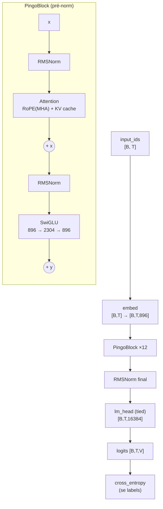

# Arquitetura do Pingo

Código: `pingo/config.py`, `pingo/model.py`, `pingo/cache.py`, `pingo/generate.py`.
Testes: `tests/test_model.py` (16 testes, config tiny, CPU).

> [!abstract] Resumo
> Decoder-only **estilo moderno simples**: `RMSNorm` pré-norm, atenção causal multi-head com
> **RoPE**, MLP **SwiGLU**, *tied embeddings*, sem viés, sem dropout, contexto 2048.
> **127.555.456 parâmetros** em 12 camadas com $d_{model}=896$.

## O config (default = Pingo-120M)

```python
PingoConfig(
    vocab_size=16_384, hidden_size=896, num_hidden_layers=12,
    num_attention_heads=14, head_dim=None,        # → 896 // 14 = 64
    intermediate_size=2_304, max_position_embeddings=2_048,
    rope_theta=10_000.0, rms_norm_eps=1e-6, initializer_range=0.02,
    bos_token_id=0, eos_token_id=1, pad_token_id=2, tie_word_embeddings=True,
)
```

| Config | Camadas | $d$ | Heads | head_dim | SwiGLU | Params | Tokens |
|---|---|---|---|---|---|---|---|
| **Pingo-120M** ✅ | 12 | 896 | 14 | 64 | 2304 | 127.555.456 | 2,75B |
| Pingo-100M (debug) | 12 | 768 | 12 | 64 | 2048 | ~100M | ~2B |
| Pingo-350M (Fase 2, suspenso) | 24 | 1024 | 16 | 64 | 2816 | ~335M | ~6B |

Há duas validações no construtor: `hidden_size % num_attention_heads == 0` e, se `head_dim`
não for passado, `head_dim = hidden_size // num_attention_heads`. Aqui $14 \times 64 = 896$,
então $d_{model} = H \cdot D$ exatamente — não há GQA nem projeção extra.

## O bloco, e o fluxo de tensores



Equações do bloco ($\ell = 1..L$):

$$
\begin{aligned}
h^{(\ell)} &= x^{(\ell-1)} + \mathrm{Attn}\big(\mathrm{RMSNorm}(x^{(\ell-1)})\big),\\
x^{(\ell)} &= h^{(\ell)} + \mathrm{SwiGLU}\big(\mathrm{RMSNorm}(h^{(\ell)})\big),
\end{aligned}
\qquad
\text{logits} = W_{\text{emb}}^{\top}\,\mathrm{RMSNorm}(x^{(L)})
$$

O último passo é literalmente o *tie*: `lm_head.weight is embed.weight` ([[Inicialização e embeddings tied]]).

## Shapes, módulo por módulo

| Módulo | Entrada | Saída | Params (por bloco) |
|---|---|---|---|
| `embed` | `[B,T]` int | `[B,T,896]` | 14.680.064 (global) |
| `RMSNorm` | `[B,T,896]` | `[B,T,896]` | 896 |
| `q/k/v_proj` | `[B,T,896]` | `[B,T,896]` | 3 × 803.328 |
| RoPE | Q,K `[B,H,T,64]` | idem (rotacionado) | **0** (sem parâmetros) |
| `o_proj` | `[B,T,896]` | `[B,T,896]` | 803.328 |
| `gate/up_proj` | `[B,T,896]` | `[B,T,2304]` | 2 × 2.064.384 |
| `down_proj` | `[B,T,2304]` | `[B,T,896]` | 2.064.384 |
| `lm_head` | `[B,T,896]` | `[B,T,16384]` | 0 (tied) |

## Decisões de desenho (e a razão de cada uma)

| Escolha | Alternativa | Por que esta |
|---|---|---|
| **Pré-norm** | post-norm (GPT-2) | treina mais estável em profundidade; o residual fica "limpo" |
| **RMSNorm** | LayerNorm | menos operações, sem média, sem viés; mesma qualidade em LLM |
| **RoPE** | embedding posicional aprendido | relativo por construção e extensível a contexto maior sem retreinar tudo |
| **SwiGLU** | GeLU MLP | melhor loss por parâmetro (prática Llama/PaLM) |
| **Lineares sem viés** | com viés | o viés não agrega em pré-norm; economiza e simplifica |
| **Tied embeddings** | duas matrizes | economiza 14,7M params (11,5%) e melhora regularização |
| **SDPA** | atenção escrita à mão | kernel fundado (Flash/Mem-efficient) de graça, sem perder controle |
| **Est. em fp32 no norm** | tudo bf16 | evita perda de precisão na estatística (bf16 tem 8 bits de mantissa) |
| **Sem dropout** | 0.1 | pré-treino com 2,75B tokens não precisa; SFT com 30k pode precisar (futuro) |

## A `forward` e seus cinco argumentos

```python
PingoLM.forward(input_ids, position_ids=None, labels=None,
                cache=None, attention_mask=None) -> CausalLMOutputWithPast
```

| Arg | Uso |
|---|---|
| `input_ids` | `[B,T]`, sempre |
| `position_ids` | default `0..T-1`; **com cache**, `cache.cur_len .. cur_len+T-1` |
| `labels` | `[B,T]`; `-100` ignora (default do `cross_entropy`) — SFT usa isso |
| `cache` | `PingoCache` para geração incremental ([[KV cache]]) |
| `attention_mask` | `[B,T]` 1=real/0=pad; **exclusivo com `cache`** |

> [!warning] `attention_mask` e `cache` são mutuamente exclusivos
> O cache é inferência de batch 1 (sem padding); a máscara é treino (batch com pad). Misturar
> os dois levanta `ValueError` — decisão de projeto para não ter um `if` cheio de casos
> silenciosos dentro da atenção ([[Atenção causal]]).

## O que o modelo **não** tem (de propósito)

- **GQA/MQA** (14 heads iguais para Q/K/V): ganho de memória de cache não justifica agora.
- **Dropout**, **LayerScale**, **QK-norm**.
- **FlashAttention custom**: usamos `F.scaled_dot_product_attention`, que já escolhe kernel.
- **Bias** em qualquer linear.

## Tamanho em memória (o que isso custa)

| Item | Cálculo | Valor |
|---|---|---|
| Pesos fp32 | $127{,}56\text{M} \times 4$ B | 510 MB |
| Pesos bf16 | $\times 2$ B | 255 MB |
| Estados AdamW ($m$, $v$ em fp32) | $2 \times 510$ MB | 1.020 MB |
| **`ckpt.pt`** (pesos + otimizador + RNG) | | **≈ 1,5 GB** |

Mais ativações e o KV cache ([[KV cache]]) — daí os 18,8 GiB medidos com `--compile`
([[Benchmarks na GPU]]).

## Ver também

- [[RMSNorm]] · [[RoPE]] · [[Atenção causal]] · [[SwiGLU]]
- [[Inicialização e embeddings tied]] · [[Contagem de parâmetros]]
- [[KV cache]] · [[Geração (sampling)]]
- [[Pingo]] — voltar ao índice
