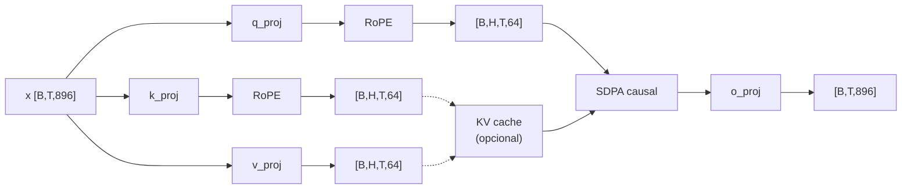

# Atenção causal (MHA)

```python
class Attention(nn.Module):
    q_proj, k_proj, v_proj: Linear(896, 896, bias=False)
    o_proj:                 Linear(896, 896, bias=False)   # escala 1/√(2L) no init
```

Causa: 14 heads de dimensão 64 → $14 \times 64 = 896$, sem GQA.

## A conta

$$
\mathrm{Attn}(Q,K,V) = \mathrm{softmax}\!\left(\frac{QK^{\top}}{\sqrt{d_k}} + M\right)V,
\qquad d_k = 64,\;\; \frac{1}{\sqrt{d_k}} = \frac18
$$

com $M_{ij} = 0$ se $j \le i$ (pode atender) e $-\infty$ caso contrário.

O fator $1/\sqrt{d_k}$ existe porque $q\cdot k$ de vetores aleatórios de dim $d$ tem desvio
padrão $\sqrt{d}$; sem dividir, o softmax saturaria (gradiente $\to 0$).

## Fluxo dentro do bloco



`_split()` faz `view(B,T,H,D).transpose(1,2)` — a ordem "heads antes do tempo" é o layout que
o SDPA espera.

## As duas máscaras (e por que elas nunca andam juntas)

O Pingo tem **dois** modos de atenção, e a diferença é *quem* impõe a causalidade:

| Modo | Como a causalidade é imposta | `is_causal` no SDPA |
|---|---|---|
| **treino, sem padding** | pelo próprio SDPA | `is_causal=True` |
| **treino, com padding** | pela máscara `attn_mask` (bool) | `is_causal=False` |
| **prefill com cache vazio** | `is_causal=True` (t == kv_len) | `True` |
| **decode (1 token, cache cheio)** | nada a mascarar: a query vê todo o passado | `False` |

### A máscara de padding, montada no `PingoLM`

```python
keep   = attention_mask.bool()[:, None, None, :]      # [B,1,1,T]  1 = token real
causal = torch.ones(t, t, dtype=torch.bool).tril()    # [T,T]      triangular inferior
attn_mask = keep & causal                             # [B,1,T,T]
attn_mask[:, :, :, 0] = True                          # nenhuma linha 100% falsa
```

> [!bug] A linha forçada em `True` não é cosmética
> Com padding **à direita** e batch de tamanhos diferentes, uma pergunta (query) que está na
> região de padding teria **todas** as chaves mascaradas. `softmax` de uma linha toda
> $-\infty$ = `NaN`, que contamina o gradiente do batch inteiro. Forçar a coluna 0 (que é
> sempre um token real, o primeiro) garante pelo menos uma chave visível. O lugar certo é
> mascarar a *loss* nessas posições (o SFT faz isso com `-100`), mas a atenção tem de ser
> numericamente sã de qualquer forma.

> [!warning] Por que não passar máscara **e** `is_causal=True`
> O comportamento do SDPA com as duas coisas é ambíguo entre backends (alguns kernels ignoram
> uma, outros aplicam em ordem diferente). O código é explícito: `is_causal = attn_mask is None`.

## Padding à direita: por que importa para RoPE

Com pad **à esquerda** (como em geração de texto), os tokens reais ficariam em posições
`k..n-1` e o RoPE precisaria de deslocamento (`position_ids`) para não "gastar" posições no pad.
Com pad **à direita**, os tokens reais ocupam **0..n-1** sempre → `position_ids = arange(T)`
está correto para toda a linha, sem caso especial. É a razão de `collate()` ([[Treino SFT]])
padded à direita.

## Custo

| Etapa | FLOPs por camada (aprox.) | Comentário |
|---|---|---|
| projeções QKV+O | $4 \cdot B T d^2$ | dominante em $T$ pequeno |
| scores $QK^\top$ | $2 \cdot B H T^2 D = 2 B T^2 d$ | **quadrático** em $T$ |
| softmax + $PV$ | $\sim 2 B T^2 d$ | idem |

Com $T=2048$ e $d=896$: $T^2 d \approx 3{,}8\times10^{9}$ por sequência por camada — é o
termo que dobra de custo quando se dobra o contexto, e é exatamente o que o **KV cache**
elimina na geração ([[KV cache]]).

## Ver também

- [[RoPE]] — aplicado em Q e K antes do SDPA
- [[KV cache]] — o "terceiro modo" da atenção
- [[Treino SFT]] — quem liga a `attention_mask` de verdade
- [[Pingo]] — voltar ao índice
