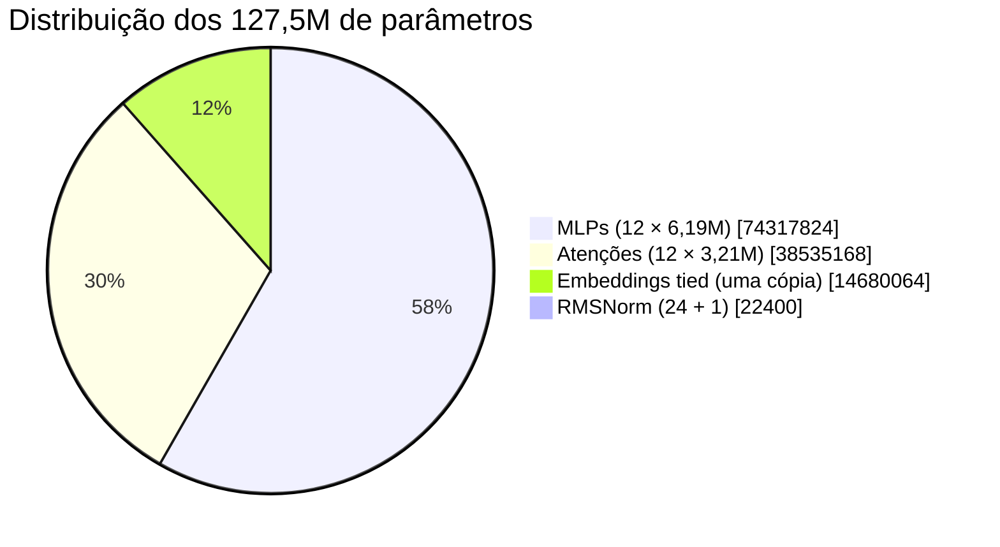

# Contagem de parâmetros

O critério do `PLAN.md` era "contagem de params bate com o alvo (~125M)". Bateu —
**127.555.456**, verificado em `tests/test_model.py::test_contagem_params_pingo120m` (que
constrói o modelo real e conta `sum(p.numel())`, não uma fórmula paralela).

## A fórmula fechada

Para $V$ vocab, $L$ camadas, $d$ = `hidden_size`, $h$ = `intermediate_size`, com $H\cdot D = d$:

$$
\boxed{
N = \underbrace{V d}_{\text{embed (tied)}}
\;+\; L\Big(\underbrace{4d^2}_{\text{q,k,v,o}} + \underbrace{3dh}_{\text{gate,up,down}}
+ \underbrace{2d}_{\text{2 RMSNorm}}\Big)
\;+\; \underbrace{d}_{\text{RMSNorm final}}
}
$$

O `lm_head` **não** entra: é o mesmo tensor de `embed` ([[Inicialização e embeddings tied]]).

## Substituindo os números

| Componente | Conta | Params | % do total |
|---|---|---|---|
| `embed` (tied) | $16\,384 \times 896$ | 14.680.064 | 11,51% |
| `q_proj` | $896 \times 896$ | 802.816 | |
| `k_proj` | $896 \times 896$ | 802.816 | |
| `v_proj` | $896 \times 896$ | 802.816 | |
| `o_proj` | $896 \times 896$ | 802.816 | |
| **atenção, por bloco** | $4d^2$ | **3.211.264** | |
| `gate_proj` | $896 \times 2304$ | 2.064.384 | |
| `up_proj` | $896 \times 2304$ | 2.064.384 | |
| `down_proj` | $2304 \times 896$ | 2.064.384 | |
| **MLP, por bloco** | $3dh$ | **6.193.152** | |
| 2 RMSNorm | $2 \times 896$ | 1.792 | |
| **bloco completo** | | **9.406.208** | |
| × 12 camadas | $12 \times 9\,406\,208$ | **112.874.496** | 88,49% |
| RMSNorm final | 896 | 896 | 0,0007% |
| **TOTAL** | | **127.555.456** | 100% |

Conferindo a soma:

$$
14\,680\,064 + 112\,874\,496 + 896 = 127\,555\,456 \;\;✓
$$

## Onde estão os parâmetros

Comentário: **58% MLP, 30% atenção, 11,5% embedding**. É um perfil típico de LLM moderno —
e explica por que aumentar `intermediate_size` é a alavanca de capacidade mais "barata" em
FLOPs por parâmetro, enquanto aumentar o vocabulário é a mais cara em memória de embedding.

## Regras de bolso que saem daí

- **Tokens por parâmetro**: 2,75B / 127,6M ≈ **21,6** (dentro da faixa "Chinchilla" de ~20).
- **Custo de +1.024 no vocab**: $+1024\times896 = 917.504$ params (0,7%).
- **Custo de +1 camada**: $+9.406.208$ params (7,4%) e +8% de FLOPs por token.
- **`head_dim` 64 com 14 heads** é a razão de $4d^2$ ser exatamente $4 \times 802\,816$: não há
  projeção extra de "head dim → d" porque $H\cdot D = d$.

## Memória

| Item | Conta | Valor |
|---|---|---|
| Pesos fp32 | $N \times 4$ B | 510 MB |
| Pesos bf16 | $N \times 2$ B | 255 MB |
| AdamW $m+v$ (fp32) | $2N \times 4$ B | 1.020 MB |
| **Checkpoint** | pesos fp32 + estados | **≈ 1,5 GB** |

Com `--compile` as ativações caem (fusão), e o pico medido do treino foi **18,8 GiB** a
B=16 × ctx 2048 ([[Benchmarks na GPU]]).

## Ver também

- [[Arquitetura do Pingo]] — o desenho
- [[SwiGLU]] — por que $h = 2304$
- [[Inicialização e embeddings tied]] — por que o `lm_head` não conta
- [[Pingo]] — voltar ao índice
