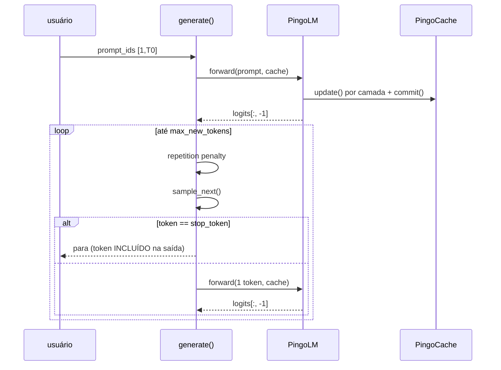

# Geração (sampling)

Código: `pingo/generate.py` — `sample_next()`, `apply_repetition_penalty()`, `generate()`.
Não usamos `model.generate()` do HF: o loop é nosso, para controlar cache, semente e parada.

## As peças

```python
def sample_next(logits, temperature=1.0, top_k=None, top_p=None):
    if temperature <= 0:  return logits.argmax(-1, keepdim=True)      # greedy
    x = logits.float() / temperature
    # top-k: mantém só os k maiores
    # top-p: núcleo por probabilidade acumulada
    return torch.multinomial(x.softmax(-1), num_samples=1)
```

### Greedy

$$
\hat t = \arg\max_v \ell_v
$$

Determinístico. No Pingo-120M ele **entra em loop** de repetição (fenômeno clássico de modelo
pequeno): "…está a ser implementado." repetido até o limite.

### Temperatura

$$
p_v = \mathrm{softmax}\!\left(\frac{\ell}{T}\right)_v
$$

$T<1$ afia (mais perto de greedy), $T>1$ achata (mais criativo/mais erro). O default do
`sample.py` é $T=0{,}8$.

### Top-k

Só os $k$ tokens de maior logit continuam com probabilidade; o resto vira $-\infty$. Implementado
por limiar: acha o k-ésimo maior valor e mascara tudo abaixo.

### Top-p (núcleo)

Ordena os logits, acumula probabilidade e corta quando a massa já acumulada **passa** de $p$:

```python
keep = sorted_x.cumsum(-1).sub(sorted_x) < top_p   # "massa ANTES deste token" < p
```

O `.sub(sorted_x)` é o detalhe que **sempre mantém o melhor token** (senão, com $p$ pequeno, o
top-1 poderia ser cortado).

### Repetition penalty

```python
sel = out[0, seen_ids]
out[0, seen_ids] = where(sel > 0, sel / penalty, sel * penalty)
```

$$
\ell'_v =
\begin{cases}
\ell_v / p, & \ell_v > 0,\\[2pt]
\ell_v \cdot p, & \ell_v \le 0,
\end{cases}
\qquad p = 1{,}15
$$

É a semântica do HF, incluindo o `else` (logit negativo é *multiplicado*, ficando mais
negativo — o que também reduz a probabilidade). `penalty = 1.0` é no-op.

> [!tip] `1.15` é o antídoto do loop
> Com penalidade ligada, o greedy do 120M sai do loop e passa a escrever frases distintas. É o
> default de `scripts/sample.py`, de `eval_sft.py` e de toda a avaliação qualitativa.

## O loop de geração



Dois detalhes que já causaram confusão:

1. **`stop_token` é incluído na saída.** `<|end|>` faz parte de `ids` retornado. Todo consumidor
   que mede texto precisa removê-lo — `limpar_geracao()` em `eval_sft.py` faz isso, e
   `terminou` é medido **no texto cru** ([[Avaliação SFT]]).
2. **`generate()` é batch=1** por decisão explícita (`ValueError` se B>1). O benchmark, que é
   batched, usa `generate_cached()` próprio em `scripts/sample.py`.

## Sementes

`generate(..., seed=13)` faz `torch.manual_seed(seed)` antes do loop — reprodutibilidade exata
para o mesmo prompt/params/device. `test_generate_stochastic_seeds` garante que (a) a mesma
semente repete e (b) sementes diferentes divergem.

## Parar no fim do contexto

Se `cache.cur_len >= max_position_embeddings`, o loop para. O prompt já é validado:
`prompt.shape[1] >= max_position_embeddings` → `ValueError` "prompt não cabe no contexto".

> [!bug] Bench com `ctx == max_position_embeddings` não gera nada
> O cache pré-alocado tem `max_seq = 2048`; um prompt de exatamente 2048 tokens deixa zero
> espaço, e os dois caminhos (com e sem cache) saem na hora — speedup de 1,0× sem qualquer erro.
> Por isso `scripts/sample.py` corta o ctx para `max_ctx - n_new` e marca
> `ctx_ajustado: true` no JSON ([[Perplexidade e KV cache]]).

## Ver também

- [[KV cache]] — o que faz o decode ser barato
- [[Avaliação SFT]] — como a geração é medida
- [[Gotchas]] — o `stop_token` incluído e o ctx cheio
- [[Pingo]] — voltar ao índice
