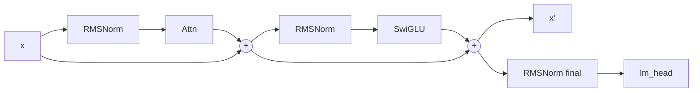

# RMSNorm

```python
class RMSNorm(nn.Module):
    def forward(self, x):
        norm = x.float().pow(2).mean(-1, keepdim=True).add(self.eps).rsqrt()
        return (x.float() * norm).to(x.dtype) * self.weight
```

## A fórmula

$$
\mathrm{RMSNorm}(x)_i \;=\; \frac{x_i}{\sqrt{\tfrac{1}{d}\sum_{j=1}^{d} x_j^2 + \varepsilon}}
\;\odot\; \gamma_i
$$

com $\varepsilon = 10^{-6}$ (o `rms_norm_eps` do config) e $\gamma \in \mathbb{R}^d$ aprendido,
**inicializado em 1**.

## Qual é a diferença para LayerNorm

LayerNorm normaliza *e* centraliza:

$$
\mathrm{LN}(x)_i = \frac{x_i-\mu}{\sqrt{\sigma^2+\varepsilon}}\,\gamma_i + \beta_i,
\qquad \mu = \frac1d\sum_j x_j,\;\; \sigma^2 = \frac1d\sum_j (x_j-\mu)^2
$$

RMSNorm joga fora $\mu$ e $\beta$. Três consequências:

| | LayerNorm | RMSNorm |
|---|---|---|
| centra na média | sim | **não** |
| parâmetros | $2d$ ($\gamma$, $\beta$) | **$d$** ($\gamma$) |
| operações em 896 dims | média + variância | **só o quadrado médio** |
| funciona tão bem? | baseline | **sim** — é o padrão de Llama, PaLM, Gemma, T5 |

Por que funciona sem centrar: o *residual stream* dos transformers já é enviesado, e o que a
norma precisa controlar é a **escala** (o RMS), não a posição. A média carrega informação
("este token está deslocado"), e removê-la é justamente a hipótese: essa informação não é
necessária para a próxima camada, e o ganho computacional é real (uma passada a menos no
tensor inteiro).

## Por que calcular a estatística em `float()` (fp32)

Em bf16, um número tem **8 bits de mantissa** — ~2–3 dígitos decimais. O termo
$\sum_j x_j^2$ em 896 dimensões pode chegar a $\approx 10^2$ com $x_j \sim 1$; em bf16, o
arredondamento de cada $x_j^2$ injeta erro relativo $\sim 2^{-8} \approx 0{,}4\%$ na
**variância**, e o erro se propaga direto para o $1/\sqrt{\cdot}$. Em fp32 (24 bits de
mantissa) o mesmo cálculo tem erro $\sim 10^{-7}$.

O custo é uma cópia fp32 do tensor dentro do norm (896 floats por token) — irrelevante perto
das GEMMs, e é o que a maioria das implementações de produção faz.

> [!note] `rsqrt`
> `rsqrt(v) = 1/√v`. É uma instrução única na GPU (e estável em fp32), mais barata e mais
> precisa que `1 / sqrt(v)` com divisão de verdade.

## O que o `weight` faz

$\gamma$ é **multiplicativo e por canal**. Sem ele, a normalização forçaria todo vetor a ter
RMS $=1$, o que tira a liberdade da rede de escolher a escala de cada dimensão. Com $\gamma$,
a camada pode "reabrir" canais importantes. Iniciar em 1 significa: no começo do treino, a
camada é uma normalização pura; o treino decide depois quais canais amplificar.

## Onde ele aparece no Pingo

Cada `PingoBlock` tem **duas** RMSNorm (uma antes da atenção, uma antes do MLP) e o modelo tem
uma **RMSNorm final**, antes do `lm_head`:



Total de parâmetros em normas: $2 \times 12 \times 896 + 896 = 22.400$ (0,018% do modelo).

> [!bug] `torch.Tensor.ones_()` não existe
> Para inicializar $\gamma = 1$ o código usa `weight.data.fill_(1.0)`. O erro original
> (`ones_` não existe) foi uma das pegadinhas de escrita do `_init_weights`
> ([[Gotchas]]).

## Ver também

- [[Arquitetura do Pingo]] — onde ele entra
- [[Inicialização e embeddings tied]] — quem inicializa $\gamma$
- [[Pingo]] — voltar ao índice
