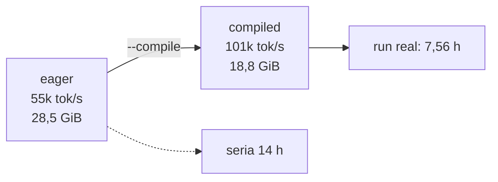

# Benchmarks na GPU

Todos os números desta nota foram **medidos** na RTX PRO 4500 (32.623 MiB), com o Strata
derrubado. São a base das decisões de batch, `--compile` e VRAM.

## Throughput e `torch.compile`

| Configuração | tok/s | VRAM de pico |
|---|---|---|
| B16 × accum16, **eager** | ~55k | **28.531 MiB** |
| B16 × accum16, **`--compile`** | **~102k** | **18,8 GiB** |
| B12 × accum16, `--compile` | — | 14,5 GiB |
| B32 (qualquer) | — | **não cabe** |

Dois achados que **não** eram esperados:

1. **Quase 2× mais rápido** (55k → 102k). A explicação: fusão de `rmsnorm`, `swiglu` e dos
   pontos de materialização, reduzindo a ida e volta para a HBM.
2. **Menos VRAM** (28,5 GiB → 18,8 GiB). Compilar não deveria mudar a memória... exceto que a
   fusão **elimina ativações intermediárias** que o eager mantinha vivas para o backward.

Consequência direta: o run planejado para ~14 h saiu em **7,56 h**.

## O bug do `--compile` que valeu um teste

Com `torch.compile`, `named_parameters()` devolve nomes prefixados (`_orig_mod.blocks.0...`).
Isso quebrou **duas** coisas silenciosamente:

| Onde | O que quebrava | Efeito |
|---|---|---|
| `build_optimizer` | `n == "embed.weight"` nunca casava | o embedding caía no grupo **com** weight decay |
| `save_ckpt` | chaves salvas com prefixo | `--resume` só funcionava se `--compile` estivesse ligado |

Correção: `unwrapped = getattr(model, "_orig_mod", model)` em `build_optimizer`, `save_ckpt` e
no `--resume`. A regressão ficou coberta por
`test_optimizer_com_pesos_de_compile`.

> [!tip] Lição
> `torch.compile` não é "flag de velocidade": ele muda a **identidade dos módulos**. Qualquer
> código que olhe nomes de parâmetros precisa desembrulhar.

## Smoke run antes do run real

`runs/smoke-120m`: B16 × accum16, **44 steps** (≈ 23 min de dados, ~2 min de run curto) para
validar a fiação de ponta a ponta:

- loss 9,85 → 8,12; val 8,63 → 8,07 (ppl 3.186);
- `ckpt.pt` + `final/` + `--resume` funcionando na prática (tokens contínuos, curva sem quebra);
- VRAM de pico confirmou que B=32 não caberia.

`runs/bench-b16-compile` e `runs/bench-b12-compile` guardam os benchmarks de throughput;
`runs/test-resume-compile` é o teste de resume com compile; `runs/dryrun-cpu` é o dry-run em
CPU com config tiny.

## Tabela de decisão: o que cabe na placa

| Item | Conta | Valor |
|---|---|---|
| Pesos bf16 | 127,6M × 2 B | 255 MB |
| Pesos fp32 (AdamW master) | × 4 B | 510 MB |
| AdamW $m,v$ | 2 × 510 MB | 1.020 MB |
| Gradientes bf16 | | 255 MB |
| Ativações (B16 × ctx 2048, compiled) | medido | ~17 GiB |
| KV cache (inferência só) | B16 × 2048 | 1,31 GiB |

Ou seja: o treino **não** é limitado por pesos (1,8 GB), é limitado por **ativações**. Daí a
sensibilidade a `B`, `ctx` e `--compile`.

## Regras práticas (para quem for rodar de novo)

- **OOM** → baixe `B` e suba `accum` na mesma proporção (o batch global fica igual, a curva
  idêntica).
- **NaN** → corte o lr pela metade (1,5e-4) e recomece do zero; NaN em bf16 quase sempre é lr
  alto no warmup.
- **Mais rápido** → `--compile` (quase 2×) e mantenha a flag **igual** entre run e `--resume`
  (hoje o ckpt é agnóstico, mas evita confusão).
- **Antes de tudo** → `nvidia-smi`: se há ~31 GB usados, o Strata está de pé ([[Infra e GPU]]).

## Ver também

- [[Run do Pingo-120M]] — o run que usou esses números
- [[Checkpoints e resume]] — o detalhe do `_orig_mod`
- [[Infra e GPU]] — a placa e as regras de convivência
- [[Pingo]] — voltar ao índice
