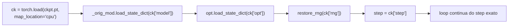

# Checkpoints e resume

> [!abstract] Critério do `PLAN.md`
> *"resume reproduz exatamente a mesma curva"*. Cumprido ao pé da letra: um run de 6 steps é
> **bit-idêntico** a um de 3 steps + `--resume` até 6 (mesmos pesos, mesma val loss) —
> `test_resume_reproduz_run_contínuo`.

## O que vai dentro do `ckpt.pt`

```python
payload = {
  "step": step,
  "model": unwrapped.state_dict(),
  "opt":   opt.state_dict(),          # AdamW: m, v, step por parâmetro
  "rng":   {"python": ...,            # random.getstate()
            "numpy":  np_rng.bit_generator.state,
            "torch":  torch.get_rng_state(),
            "torch_cuda": torch.cuda.get_rng_state()},
  "args":  vars(args),                # a receita completa, p/ auditoria
}
```

**Por que os RNGs são obrigatórios.** Todo step consome aleatoriedade em dois lugares: o
`get_batch` (np.random.Generator) e qualquer dropout/init posterior (torch). Se você restaurar
pesos e otimizador mas não os RNGs, o run "retomado" vê **batches diferentes** — a curva não
reproduz, e o erro é invisível (a loss até cai).

> [!note] O SFT faz diferente (e melhor)
> Em `train_sft.py` a ordem dos exemplos por época é **derivada** de
> `np.random.default_rng([seed, epoca]).permutation(len(train))` — função pura do índice, não
> estado. Assim o resume não precisa guardar a ordem (só os RNGs de verdade). É o padrão "stateless
> shuffling", mais robusto contra exatamente esse tipo de esquecimento.

## Gravação atômica + rotação

```python
tmp = path.with_suffix(".tmp")
torch.save(payload, tmp)
if path.exists():
    path.replace(path.with_name("ckpt-prev.pt"))   # 1 geração anterior
tmp.replace(path)                                  # rename atômico
```

- **Atomicidade**: nunca existe `ckpt.pt` meio escrito. Se a máquina cair durante o save, o pior
  caso é um `.tmp` corrompido — e o `ckpt.pt` anterior continua válido.
- **Rotação**: `ckpt-prev.pt` guarda a geração imediatamente anterior. Custa 1,5 GB extra, mas
  salva de "o último checkpoint estava corrompido".
- **Por tempo, não por step**: `--ckpt-min 15` checa `time.time() - last_ckpt`. Como o
  throughput pode variar (compile, contenção de GPU), salvar por tempo garante que você perde
  no máximo ~15 min de treino em qualquer cenário.

**Tamanho**: pesos fp32 (510 MB) + AdamW $m,v$ (1.020 MB) + o resto ≈ **1,5 GB** por arquivo.
Com `ckpt.pt` + `ckpt-prev.pt` + `best.pt` + `final/`, o diretório `runs/pt-120m/` tem 4,8 GB.

## O `--resume`, passo a passo



Três armadilhas reais, todas resolvidas:

| Armadilha | Sintoma | Solução |
|---|---|---|
| `--compile` prefixa as chaves (`_orig_mod.`) | resume só funciona com compile ligado | salvar/restaurar via `getattr(model, "_orig_mod", model)` |
| lr não está no ckpt | curva de lr salta | usar sempre o mesmo `--max-steps`/`--lr` |
| RNG de CUDA não restaurado | batches e dropout divergem | `torch.cuda.set_rng_state` no `restore_rng` |

> [!warning] `--resume` sem `ckpt.pt` é erro, não "começar do zero"
> `FileNotFoundError` explícito. Começar de novo é sem `--resume` — e isso **sobrescreve**
> `runs/pt-120m/`. Como esse diretório guarda o melhor modelo (e só existe um), há o backup
> read-only `runs/pt-120m-BACKUP-2026-10-30/` com `SHA256SUMS.txt` conferido.

## O teste que prova o bit-exatismo

```
run A: 6 steps seguidos
run B: 3 steps → save → load → 3 steps
assert pesos A == pesos B   (torch.equal)
assert val_loss A == val_loss B
```

O teste roda em CPU de propósito: em CUDA, kernels não determinísticos (atomics do SDPA) podem
gerar diferenças de último bit. A garantia que interessa ("mesma trajetória") é verificada onde
é verificável exatamente.

## O que **não** está no checkpoint (e por que não precisa)

| Item | Onde está |
|---|---|
| Vocabulário | `tokenizer/tokenizer.json` (imutável, 16.384) |
| `max_steps`/lr | derivados de `args` + `meta.json` |
| Ordem dos batches | RNGs (+ shuffle sem estado no SFT) |
| Config do modelo | `config.json` (dentro de `final/`, e `args` no ckpt) |

## Ver também

- [[Loop de treino]] — o loop em volta
- [[Benchmarks na GPU]] — o bug do `_orig_mod` no detalhe
- [[Run do Pingo-120M]] — checkpoints reais do run
- [[Pingo]] — voltar ao índice
