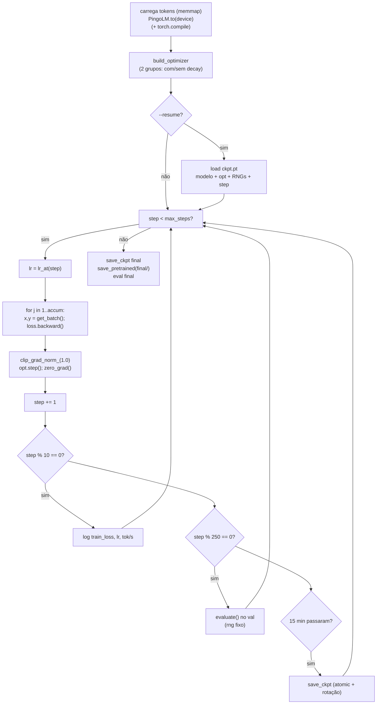

# Loop de treino (pré-treino)

Script: `scripts/train.py`. Testes: `tests/test_train.py` (5 testes, CPU, config tiny,
tokens reais em ctx 256).

## A receita, em uma tabela

| Hiperparâmetro | Valor | Arg |
|---|---|---|
| Otimizador | AdamW, $\beta=(0{,}9,\,0{,}95)$ | `--beta1/--beta2` |
| Weight decay | 0,1 — **exceto** RMSNorm (1-D) e `embed.weight` | `--weight-decay` |
| lr | $3\times10^{-4} \to 3\times10^{-5}$ (cosine) | `--lr/--min-lr` |
| Warmup | 400 steps lineares | `--warmup-steps` |
| Grad clip | 1,0 (norma global) | `--grad-clip` |
| Precisão | `autocast(bfloat16)` | fixo |
| Micro-batch | $B=16$, ctx 2048 | `--batch-size/--ctx` |
| Grad accumulation | 16 | `--accum-steps` |
| **Batch global** | $16 \times 2048 \times 16 = \mathbf{524.288}$ tokens | |
| Steps | 1 época = **5.248** | default do `meta.json` |
| Eval | a cada 250 steps, 20 batches com rng **fixo** | `--eval-steps/--eval-iters` |
| Checkpoint | a cada 15 min (por tempo, não por step) | `--ckpt-min` |
| Seed | 13 (python, numpy, torch) | `--seed` |

## O grafo do loop



## O learning rate: warmup + cosine

```python
if step < warmup:      lr = lr_max * step / warmup
elif step >= max:      lr = lr_min
else:                  p = (step - warmup) / (max - warmup)
                       lr = lr_min + 0.5*(lr_max - lr_min)*(1 + cos(pi*p))
```

$$
\eta(t) =
\begin{cases}
\eta_{\max}\dfrac{t}{W}, & t < W,\\[6pt]
\eta_{\min} + \dfrac{\eta_{\max}-\eta_{\min}}{2}\Big(1+\cos\Big(\pi\dfrac{t-W}{M-W}\Big)\Big), & W \le t < M,\\[6pt]
\eta_{\min}, & t \ge M.
\end{cases}
$$

**Warmup** existe porque, no início, os pesos são ruído e os gradientes apontam para direções
arbitrárias: um passo grande logo no step 0 pode jogar o modelo num vale ruim (ou gerar NaN).
Com 400 steps de subida, o otimizador "esquenta" as estatísticas de segundo momento do AdamW.
**Cosine** dá uma cauda longa de lr pequeno, onde o modelo refina — foi o que produziu a cauda
lisa de val loss em [[Run do Pingo-120M]].

> [!bug] O lr **não** está no checkpoint
> Ele é recalculado a cada step por `lr_at(step, max_steps)`. Portanto `--resume` **tem de usar
> o mesmo `--max-steps`** (e mesmo `--lr`/`--warmup-steps`) do começo; senão a curva de lr
> "salta" silenciosamente. Num teste manual 40→44 a curva mudou sem aviso. No run real isso não
> acontece porque o default vem do `meta.json` e é constante.

## Grupos de weight decay

```python
no_decay = {n for n, p in unwrapped.named_parameters() if p.ndim < 2 or n == "embed.weight"}
```

| Grupo | Quais | wd |
|---|---|---|
| com decay | todas as matrizes (atenção, MLP, `lm_head`) | 0,1 |
| **sem decay** | RMSNorm ($\gamma$, 1-D) e `embed.weight` | 0,0 |

A razão: weight decay é uma contração ($w \leftarrow w - \lambda w$) que empurra para zero.
Em uma **norma**, isso aprisiona a escala (o $\gamma$ deve poder crescer); em um **embedding**,
puxa os vetores de tokens raros para a origem, competindo com o sinal dos dados.

> [!bug] Com `--compile`, `named_parameters()` vem como `_orig_mod.*`
> Sem o `getattr(model, "_orig_mod", model)`, o teste `n == "embed.weight"` **nunca** casava e
> o embedding caía no grupo com decay — bug silencioso, encontrado no benchmark e coberto por
> `test_optimizer_com_pesos_de_compile` ([[Benchmarks na GPU]]).

## Gradient accumulation, sem truque

```python
for _ in range(accum):
    loss = model(x, labels=y).loss / accum
    loss.backward()
...
clip_grad_norm_(model.parameters(), 1.0)
opt.step(); opt.zero_grad(set_to_none=True)
```

Dividir a loss por `accum` faz o gradiente acumulado ser a **média** dos micro-batches (não a
soma). Consequência importante: o `clip_grad_norm_` e o lr são os mesmos que se o batch global
coubesse na VRAM. E `zero_grad(set_to_none=True)` (em vez de zerar) evita uma passada de
escrita em todos os gradientes.

`loss_sum` acumula `loss.float().item()` **já dividida** por accum, então a média logada por
step é a média real dos 16 micro-batches.

## Avaliação durante o treino: a mesma régua, sempre

```python
eval_rng = np.random.default_rng(20_260_101)     # FIXO
for _ in range(args.eval_iters):                 # 20
    x, y = data.get_batch("val", 16, 2048, eval_rng)
```

Os **mesmos 20 batches** em toda avaliação → a curva de val loss é comparável entre steps,
entre checkpoints e entre runs (é a mesma semente de `scripts/sample.py`, o que faz o 2,507 do
treino e o 2,4571 da avaliação diferirem só pelo número de batches/B —
[[Perplexidade e KV cache]]).

Custo de cada eval: 20 × 16 × 2048 = **655.360 tokens** (≈ 6 s).

## Tratamento de interrupção

`except KeyboardInterrupt` salva o checkpoint antes de propagar. No run real havia ainda um
**vigia externo** (fora do repositório) que lia `log.jsonl`, copiava `best.pt` e mandava SIGINT
se o val piorasse duas vezes seguidas ou aparecesse NaN. A lógica de "melhor checkpoint" ficou
no SFT (`best.pt` é salvo pelo próprio `train_sft.py`); no pré-treino ela ficou fora, por
simplicidade.

## Ver também

- [[Checkpoints e resume]] — como o estado é salvo/restaurado
- [[Run do Pingo-120M]] — a curva real
- [[Binarização e shards]] — de onde vêm `x` e `y`
- [[Pingo]] — voltar ao índice
