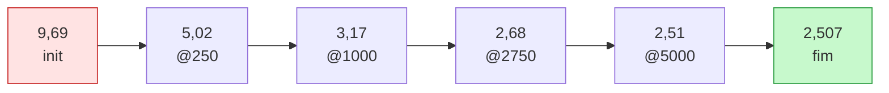

# Run do Pingo-120M

Diretório: `runs/pt-120m/` (`ckpt.pt`, `ckpt-prev.pt`, `best.pt`, `final/`, `log.jsonl`).
Backup read-only: `runs/pt-120m-BACKUP-2026-10-30/`.

> [!abstract] O run, em números
> **5.248 steps** · **2,75B tokens** · **7,56 h** · 100,9k tok/s médios · VRAM 18,8 GiB ·
> GPU 84–86 °C · **zero NaN** · val loss **9,69 → 2,507** (ppl 12,3) · `--resume` validado.

## Comando

```bash
uv run python scripts/train.py --compile
```

(Nada mais: os defaults são os do `PLAN.md`, e `max_steps` é calculado do `meta.json`.)

## A curva de validação (a curva real, do `log.jsonl`)

| step | val loss | ppl | tokens vistos |
|---|---|---|---|
| init | 9,69 | 16.200 (≈ ln 16384) | 0 |
| 250 | 5,0215 | 151,6 | 0,13B |
| 500 | 3,9750 | 53,2 | 0,26B |
| 750 | 3,4197 | 30,6 | 0,39B |
| 1000 | 3,1656 | 23,7 | 0,52B |
| 1250 | 3,0267 | 20,6 | 0,66B |
| 1500 | 2,9390 | 18,9 | 0,79B |
| 1750 | 2,8683 | 17,6 | 0,92B |
| 2000 | 2,8079 | 16,6 | 1,05B |
| 2250 | 2,7607 | 15,8 | 1,18B |
| 2500 | 2,7227 | 15,2 | 1,31B |
| 2750 | 2,6849 | 14,7 | 1,44B |
| 3000 | 2.6553 | 14,2 | 1,57B |
| 3250 | 2,6297 | 13,9 | 1,70B |
| 3500 | 2,6042 | 13,5 | 1,83B |
| 3750 | 2,5813 | 13,2 | 1,97B |
| 4000 | 2,5611 | 12,9 | 2,10B |
| 4250 | 2,5464 | 12,8 | 2,23B |
| 4500 | 2,5319 | 12,6 | 2,36B |
| 4750 | 2,5220 | 12,5 | 2,49B |
| 5000 | **2,5139** | 12,4 | 2,62B |
| 5248 (fim) | **2,507** | 12,3 | 2,75B |



### Como ler a curva (as três fases)

1. **steps 0–500 (queda brutal: 9,69 → 3,98)**: o modelo aprende a estatística de unigramas e
   bigramas — que `a` vem depois de `de`, que `ç` é raro, que `<|eos|>` existe. Quase toda a
   "estrutura de superfície" do português cabe aqui.
2. **steps 500–2750 (3,98 → 2,68)**: sintaxe e colocações; é a região onde o custo por bit
   começa a doer.
3. **steps 2750–5248 (2,68 → 2,51)**: ganhos decrescentes (Lei de potência). Vale notar que a
   loss ainda caía de 2,514 a 2,507 nos últimos 250 steps: **não saturamos**; o limite aqui foi
   tokens, não arquitetura.

Expectativa do `PLAN.md` era 3,2–3,9 em val loss (estimativa a partir de outros 120M). Saiu
**2,51** — muito melhor. O motivo provável: tokenizer de 16k afinado em pt (mais bits por
token) + 21,6 tokens por parâmetro + curva limpa sem instabilidade.

> [!note] `bits/token` é a métrica comparável entre tokenizers
> Loss 2,4571 (na avaliação) = **3,54 bits/token**. É esse número que se compara com a
> literatura quando o tokenizer muda — ppl não é comparável entre vocabulários diferentes.

## Amostras qualitativas (o que 127M consegue)

**Greedy** (`temperature=0`) → **loop de repetição**, como esperado num modelo pequeno:

```
O Brasil é um país de língua portuguesa, com uma população de mais de 1,5 milhão de pessoas.
O Brasil é um país de língua portuguesa, com uma população de mais de 1,5 milhão de pessoas.
... (repete até o limite)
```

**Amostragem** (`T=0.8, top_k=50, repetition_penalty=1.15`) → parágrafos coerentes:

```
O Brasil é um país de língua portuguesa. A tradução e a interpretação do texto no idioma
original fazem parte da obra Contos sem Paixões, que também contém spoilers sobre o contexto
cultural, histórico, social e político brasileiro. O livro narra as aventuras cotidianas de uma
jovem que se apega aos estudos universais, à escrita em família, ao trabalho da mãe na escola
pública e ao emprego informal de professores.
```

```
No ano de 2024, o governo federal anunciou que o governo federal vai lançar um programa de
incentivo fiscal para o setor de serviços. ... (na amostragem: parágrafos distintos, com
travessões, aspas e nomes próprios)
```

O que **funciona**: sintaxe, concordância, pontuação, parágrafos, registro jornalístico.
O que **não funciona**: coerência factual (mistura Selic com Anvisa, inventa nomes) e
variedade de pt ("está a ser implementado" — pt-PT, herança de [[Escolha do dataset]]).

## Custo e recursos

| Grandeza | Medido |
|---|---|
| Duração | 7,56 h (27.215 s) |
| Throughput médio | 100,9k tok/s (pico ~101,4k) |
| VRAM de pico | 18,8 GiB (B16 × accum16, `--compile`) |
| Temperatura | 84–86 °C, sem throttle |
| Steps/época | 5.248 |

## O melhor checkpoint

`best.pt` foi salvo pelo **vigia externo** no step 5000 (val 2,5139). O `final/` (HF
`safetensors` + `config.json`) é o estado do step 5248 (val 2,507) — é esse que a avaliação
usa e que o SFT usa como base.

> [!warning] Não rode `train.py` sem `--resume` neste diretório
> Sobrescreveria `runs/pt-120m/`. O backup read-only existe exatamente para isso não virar
> tragédia. O SFT grava em `runs/sft-120m/`.

## Ver também

- [[Loop de treino]] — a receita
- [[Benchmarks na GPU]] — de onde vieram as decisões de `--compile`/batch
- [[Perplexidade e KV cache]] — a avaliação formal do resultado
- [[Pingo]] — voltar ao índice
