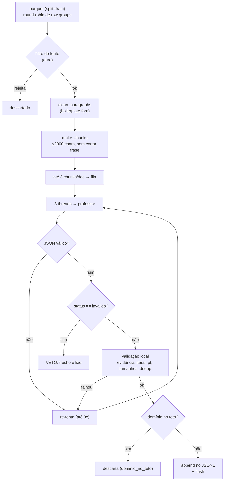

# Geração do dataset (SFT-1)

Script: `scripts/gen_sft.py` (~600 linhas) + `tests/test_gen_sft.py` (**21 testes**, professor
fake via `monkeypatch`, sem rede). Saída: `data/sft/sft-v1.jsonl` (meta **30.000** pares) +
`sft-v1.stats.json` + `sft-v1.log`.

> [!abstract] Resultado até agora
> ~**40 pares/min** com 8 slots (1,7–2,1 s/par); 30k pares ≈ **11–12 h**. Os pilotos (300
> pares cada) rodaram em **7,4 e 7,5 min** e foram auditados à mão.

## O pipeline por documento



## 1 · Filtro de fonte (duro, bem mais que o do pré-treino)

| Regra | Limiar | Motivo |
|---|---|---|
| tamanho do doc | $2000 \le n \le 60.000$ chars | texto curto não dá pergunta autossuficiente; doc gigante é coletânea |
| parágrafos úteis | **≥ 4** | menu/lista não tem prosa |
| dígitos por palavra | **≤ 0,25** | tabela de preço, planilha, listagem |
| maiúsculas | **≤ 30%** das letras | CAPS LOCK, título/post |
| links | **≤ 4** | página de links |
| **blocklist de URL** | porn, xxx, escort, casino, bet, tigrinho, slot, "assistir/dublado/legendado", megafilmes, warez… | spam que **parece** texto legível |
| **blocklist de texto** | "vídeos picantes", "conteúdo adulto explícito", "maiores de 18 anos" | idem |

```python
DENY_URL_DEFAULT = r"(?i)(porn|xxx|nsfw|hentai|escort|onlyfans|putaria|sexo\b|crack|keygen|" \
                   r"warez|torrent|nifentas|bet[0-9]{2}|casino|tigrinho|slot[s]?\b|" \
                   r"assistir|dublado|legendado|filmes?online|megafilmes|superflix|" \
                   r"series?online|baixar|gratisbaixar)"
```

> [!important] Por que a blocklist existe se o professor veta
> Porque o professor **não veta tudo**: spam adulto e pirataria passam por serem texto legível
> (achado do piloto v1). A blocklist barra **antes** da chamada, o que economiza tokens e
> impede que o assunto entre no dataset por acidente.

## 2 · Limpeza de parágrafos

`clean_paragraphs()` quebra por `\n`, colapsa whitespace e descarta linhas que:

- têm menos de **60 chars** (`min_para_chars`);
- casam com `BOILER_RE`: `facebook|twitter|whatsapp|instagram|...|compartilh|assine|publicidade|
  leia mais|voltar|início|menu|pesquisar|cookie|todos os direitos|política de privacidade|
  siga-nos|newsletter|©|copyright|<|>`;
- contêm **mais de 2 URLs** (linha que é lista de links).

## 3 · Chunking em parágrafos inteiros

```python
def make_chunks(paras, cfg):
    units = [p if len(p) <= 2000 else *_split_sentences(p) for p in paras]
    # junta parágrafos inteiros até 2000 chars; nunca corta frase
```

- Alvo: **≤ 2.000 chars** (≈ 500 tokens do nosso tokenizer) — cabe folgado em 4096 de contexto e
  deixa o prefill barato.
- Mínimo: **700 chars** (`chunk_min_chars`) — trecho curto demais não sustenta pergunta.
- Parágrafo maior que 2.000 chars é quebrado **em frases** (`split` por `[.!?]\s+`); uma frase
  gigante fica sozinha, inteira.
- Até **3 chunks por doc** (`max_per_doc`) — evita que um único artigo domine.

## 4 · O prompt v2 (com MODO)

```
MODO: ANCORADO: a pergunta será feita junto com o TRECHO, que o leitor terá em mãos — ela
pode se referir ao conteúdo ('segundo o texto', 'no caso descrito').
TIPO DE EXEMPLO: extracao
Tarefa: faça uma pergunta cuja resposta seja um fato explícito do trecho (nomes, números,
datas, lugares).

TRECHO:
<chunk>
```

O `MODO` foi a correção mais importante do piloto v1:

- **v1 (só ancorado)**: 28 de 300 perguntas citavam "o texto" — inúteis para um modelo que
  recebe só a pergunta;
- **v2 (50/50)**: no modo `SEM CONTEXTO` a pergunta é proibida de citar "texto/trecho/documento/
  artigo/fonte" (`FONTE_RE`, regex) e a recusa muda de frase.

| Modo | Pergunta | Recusa |
|---|---|---|
| **ancorado** (`true`) | pode dizer "segundo o texto" | `"Isso não consta no texto."` |
| **livre** (`false`) | tem de ser autossuficiente | `"Não tenho informações suficientes para responder isso."` |

## 5 · Schema e JSON garantido

```json
{"status": "ok|invalido", "tipo": "...", "pergunta": "...", "resposta": "...", "evidencia": "..."}
```

Todo campo obrigatório, `additionalProperties: false`, `strict: true`. Sem isso o professor
devolve texto livre e o gerador perde a chamada.

## 6 · Validação local (antes de aceitar)

`validate()` devolve `(motivo, pergunta, resposta, evidencia)`. Motivos possíveis:

| Motivo | Regra |
|---|---|
| `json_invalido` | resposta não é JSON |
| `fonte_invalida` | professor vetou o trecho (`status: invalido`) |
| `tipo_diferente` | devolveu outro `tipo` que o pedido |
| `pergunta_ruim` | não termina em `?` ou fora de 15–300 chars |
| `resposta_ruim` | fora de 10–900 chars |
| `nao_pt` | heurística `is_pt` (stopwords + acentos, ≥ 2 sinais) falhou |
| `menciona_fonte` | modo livre citando "texto/trecho/…" |
| `resposta_copia_pergunta` | resposta contida na pergunta |
| `recusa_ruim` | recusa não começa pela frase do modo |
| `recusa_com_evidencia` | recusa com `evidencia` preenchida (não devia) |
| `evidencia_vazia` | evidência < 20 chars |
| **`evidencia_nao_literal`** | evidência **não está** dentro do `chunk_text` |
| `pergunta_duplicada` | já vista (normalizada) — dedup exato em memória |
| `dominio_no_teto` | domínio atingiu o teto (5% de `--max-examples`, mínimo 3) |

Até **3 tentativas** por trecho (`--tries`), sorteando tipo e modo novos a cada tentativa.

> [!note] `evidencia_nao_literal` é o motivo mais frequente
> ~98 de 325 trechos no piloto v2. É o preço de exigir **cópia caractere por caractere**: o
> modelo às vezes parafraseia e perde a chamada. Esse rigor é o que permite afirmar que o par
> tem base no trecho.

## 7 · Concorrência e escrita

- `ThreadPoolExecutor(8)` com fila limitada a `workers × 3` futures — nunca carrega o corpus
  na memória e mantém os 8 slots sempre cheios.
- Escrita **incremental** com `flush()` por trecho concluído (+ `tqdm` com `rej`, `falhas`, `tok`).
- `--resume` lê `(doc_id, chunk_idx)` já gravados e **pula** esses trechos; o teto por domínio é
  reconstruído relendo o arquivo, para não estourar o teto ao retomar.
- `KeyboardInterrupt` para limpo: o que foi aceito já está no disco.

> [!bug] `--resume` engana o contador do `tqdm`
> A barra começa do zero: conta só os pares **deste** processo. Em 2026-10-30 14h33 ela marcava
> `5804/30000` com **8.959** linhas no arquivo (3.155 da fase anterior + 5.804 desta) e o ETA
> aparecia ~1 h maior que o real. **Sempre confira com `wc -l`.**

## 8 · O que o `stats.json` registra

`accepted`, `rejected_chunks`, `chunks`, `reasons` (contagem por motivo), `tipos`, `modos`,
`completion_tokens`, `prompt_tokens`, `elapsed_s`, `tok_s_agregado`, `examples_min`, e a
**config inteira** (para reproduzir a geração exata).

### Os dois pilotos (auditados à mão)

| | piloto v1 (só ancorado) | piloto v2 (50/50) |
|---|---|---|
| aceitos | 300 | 300 |
| trechos tentados | 339 | 325 |
| rejeitados | 39 | 25 |
| `fonte_invalida` (veto) | 51 | 48 |
| `evidencia_nao_literal` | 104 | 98 |
| `menciona_fonte` | **57** | **37** |
| duração | 459,5 s | 448,0 s |
| pares/min | 39,2 | 40,2 |
| modos | 300 ancorados | 163 ancorados / 137 livres |

O que a auditoria manual encontrou: **spam adulto e de pirataria** (→ blocklist), **28 perguntas
citando "o texto"** (→ modo misto) e respostas que copiavam a pergunta.

## Ver também

- [[Formato do exemplo]] — o JSONL que sai daqui
- [[Validação, dedup e splits]] — o que acontece com ele
- [[O professor local]] — o outro lado do HTTP
- [[Pingo]] — voltar ao índice
