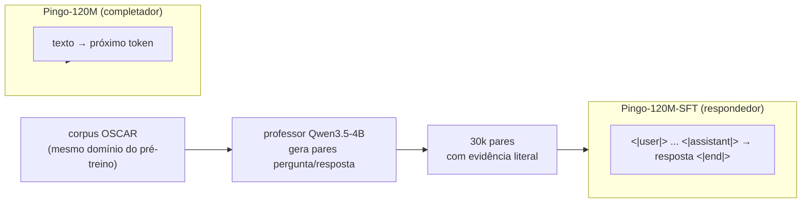

# Por que SFT

## O ponto de partida

O Pingo-120M pré-treinado é um **completador de texto**. Dado "A empresa anunciou hoje que",
ele continua a frase. Ele **não** sabe responder pergunta, não segue formato e não sabe dizer
"não sei". Três sintomas medidos:

| Sintoma | Evidência |
|---|---|
| não segue instrução | um prompt "Responda: quanto é 2+2?" vira continuação de texto |
| não tem formato de turno | não existe `<|user|>`/`<|assistant|>` no vocabulário |
| não sabe recusar | inventa com a mesma fluência com que acerta |

## A decisão de 2026-10-30: SFT **antes** de escalar

O plano original era pré-treino → **350M** → SFT → DPO. Mudou por dois motivos:

1. **O gargalo não é tamanho.** Escalar para 350M pede ~6B tokens e ~3 dias de GPU; o que falta
   ao modelo é **formato e postura**, não capacidade bruta. Um 120M bem instruído demonstra
   melhor o pipeline que um 350M sem instrução.
2. **O ciclo curto ensina mais.** SFT com professor local roda em horas, e cada etapa
   (gerador, validador, treino, avaliação) é um problema de engenharia separado e interessante.

Ver [[Decisões (ADR)]] · ADR-09.

## O objetivo, em uma frase

> Ensinar o Pingo-120M a **responder perguntas sobre o mesmo domínio em que foi pré-treinado**
> (web em português), tanto **com o trecho em mãos** (mini-RAG) quanto **sem contexto**
> (closed-book, quando ele já "sabe"), e a **recusar** quando não sabe.

## Por que dataset **sintético** (e não um dataset pronto)

| Alternativa | Problema |
|---|---|
| dataset de instruções público em pt | domínio/estilo diferente do pré-treino; licença variável; muitos são tradução do inglês |
| rotular à mão | 30k pares humanos é caro e lento |
| **professor local sobre o próprio corpus** | domínio idêntico ao pré-treino, custo ~0, cada par com procedência (`doc_id`, `url`) e **evidência literal** verificável |

A última opção tem um bônus: o professor **veta** trechos que não são texto legível
(`status: "invalido"`), virando o filtro de qualidade mais eficaz do pipeline — e de graça.

## As cinco etapas

| Etapa | O que faz | Script | Estado |
|---|---|---|---|
| **SFT-1** | gera os pares com o professor (filtro duro → chunk → prompt → validação → JSONL) | `gen_sft.py` | ✅ (rodando) |
| **SFT-2** | revalida, deduplica (MinHash/LSH) e separa train/val/heldout por documento | `validate_sft.py` | ✅ |
| **SFT-3** | treina com `attention_mask`, loss só na resposta, tokens de chat | `train_sft.py` | 🔶 escrito+testado |
| **SFT-4** | avalia formato, fidelidade e esquecimento catastrófico | `eval_sft.py` | 🔶 escrito+testado |
| **SFT-5** | (opcional) misturar 10–20% de instruções gerais para não virar "respondedor de documento" | — | ⬜ |

## A taxonomia (e por que ela é desbalanceada)

| Tipo | Fração | Pergunta típica | O que ensina |
|---|---|---|---|
| `extracao` | **50%** | "Qual é o valor total investido?" | ler o trecho e extrair um fato |
| `explicacao` | **30%** | "Por que o prazo foi estendido?" | juntar 2–3 informações |
| `resumo` | **15%** | "Sobre o que trata o texto?" | comprimir |
| `recusa` | **5%** | pergunta plausível cuja resposta **não** está no trecho | honestidade |

O desequilíbrio é proposital: 50% de extração porque é o caso mais comum e o mais verificável
(a `evidencia` literal ancora tudo); 5% de recusa porque recusar demais é tão ruim quanto
inventar.

## Os quatro riscos que o pipeline tenta fechar

1. **O professor inventa** → campo `evidencia` obrigatório e **cópia literal** do trecho
   ([[Formato do exemplo]]).
2. **O professor ensina recusa errada** → juiz de recusas ([[Juiz de recusas]]).
3. **Vazamento de documento entre splits** → split por `doc_id` + checagem de vazamento
   ([[Validação, dedup e splits]]).
4. **Esquecimento catastrófico** → ppl no val do pré-treino antes/depois
   ([[Avaliação SFT]]).

## O que **não** está no escopo

- Instruções gerais (matemática, código, redação) — é o SFT-5 opcional.
- DPO/RLHF — depois.
- Escalar para 350M — suspenso ([[Decisões (ADR)]]).

## Ver também

- [[O professor local]] — quem gera os dados
- [[Geração do dataset]] — como
- [[Treino SFT]] · [[Avaliação SFT]] — o que fazemos com os dados
- [[Pingo]] — voltar ao índice
