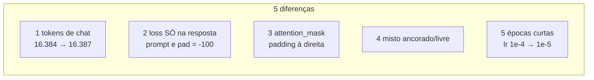

# Treino SFT (SFT-3)

Script: `scripts/train_sft.py` + `pingo/sft.py`. Testes: `tests/test_train_sft.py` (**9 testes**).
Entra `data/sft/final/{train,val}.jsonl` + `runs/pt-120m/final/`; sai `runs/sft-120m/`.

> [!abstract] Sanidade já medida (CPU, 2 steps, checkpoint real)
> train loss **3,19 → 2,32**, val **2,64**, acc **0,566**. Números de partida saudáveis —
> é o que dá para verificar sem a GPU.

## O que muda em relação ao pré-treino



### 1 · Tokens de chat (`ensure_chat_tokens` + `resize_embeddings`)

`<|user|>`, `<|assistant|>`, `<|end|>` entram como **tokens especiais** novos:

| | valor |
|---|---|
| vocab antes | 16.384 |
| vocab depois | **16.387** |
| init das linhas novas | **média** das 16.384 existentes |
| `tokenizer/tokenizer.json` | **inalterado** (16.384) |
| cópia salva no run | `runs/sft-120m/tokenizer.json` (16.387) |

```python
novo[w.shape[0]:] = w.mean(dim=0, keepdim=True).expand(acrescimo, -1)
model.embed = emb
model.lm_head.weight = emb.weight      # RE-TIE obrigatório
model.lm_head.out_features = new_size
model.config.vocab_size = new_size
```

> [!important] Por que iniciar na **média** e não em ruído
> Ruído em 3 linhas de um embedding de 896 dims é um "buraco" que o modelo leva muitos steps
> para consertar, e ele passa a produzir logits aleatórios para esses tokens — justamente os
> que **delimitam o formato de chat**. A média é o ponto "neutro" do espaço aprendido: os
> tokens novos começam sem significado próprio, mas sem perturbar o resto.
>
> O re-tie é obrigatório: trocar `model.embed` **não** atualiza `lm_head.weight`, que continua
> apontando para o tensor antigo. Coberto por `test_resize_embeddings_inicia_na_media_e_mantem_o_tie`.

### 2 · Loss só nos tokens da resposta (o bug mais caro do projeto)

O modelo prevê o **próximo** token. Portanto o label da posição $t$ é o token $t+1$:

$$
\text{labels}[t] = \text{ids}[t+1]
$$

Se a resposta começa em `np_` (o número de tokens do prompt), a resposta é prevista a partir da
posição `np_ - 1` — que é o `<|assistant|>` que fecha o prompt:

```python
labels[i, np_ - 1 : len(s) - 1] = s[np_:]
```

Diagrama de uma linha `s = [P0 P1 A0 A1 A2 END]` com `np_ = 2`:

| pos | 0 | 1 | 2 | 3 | 4 | 5 |
|---|---|---|---|---|---|---|
| `ids` | P0 | P1 | A0 | A1 | A2 | END |
| `labels` | -100 | -100 | A0 | A1 | A2 | END |
| quem prevê | (ignorado) | (ignorado) | de P1 | de A0 | de A1 | de A2 |

> [!bug] `labels[t] = ids[t]` "funciona" e destrói o treino
> Com o label alinhado errado, o modelo só precisa **copiar o token do residual stream** —
> a loss "cai" e a accuracy fica em **56%**, mas a loss estaciona em **~12** (deveria ser
> ~2,6). É o erro clássico de SFT. Regra: `labels[np_-1 : len(s)-1] = ids[np_]`.

Com `-100` nas posições de prompt e de padding, o `F.cross_entropy` do PyTorch **ignora** essas
posições (é o default dele). Não há máscara extra: a média é só sobre tokens de resposta.

### 3 · `attention_mask` e padding à direita

`pingo/model.py` passou a aceitar `attention_mask` (retrocompatível: sem máscara, o
comportamento é idêntico ao de antes). O `collate` monta:

```python
x      = pad_id onde não há token
mask   = 1 nos tokens reais, 0 no padding
labels = -100 (prompt + padding), resposta+<|end|> nas demais
length = ceil(longest / 8) * 8          # shape estável p/ torch.compile
```

**Padding à direita** porque as posições dos tokens reais ficam `0..n-1`, e o RoPE não precisa
de deslocamento ([[Atenção causal]]). **Múltiplo de 8** porque o `torch.compile` recompila a
cada shape nova; arredondar para 8 reduz drasticamente o número de shapes distintas.

### 4 · Misto ancorado / sem contexto

A serialização vem de `render()` ([[Formato do exemplo]]): metade dos exemplos leva
`Contexto: <trecho>`, metade é só `Pergunta: <...>`. O dataset já vem 50/50 e **o modelo não
sabe** qual é qual além do que está no prompt — a diferença é inteiramente textual.

### 5 · Épocas curtas

9.000 steps por época? Não: 30k pares ÷ (8 × 4) = **~938 steps/época**. Com `--epochs 3` →
~2.814 steps. Ínfimo comparado aos 5.248 do pré-treino → **lr menor** e warmup curto.

## Hiperparâmetros default

| Item | Valor |
|---|---|
| Base | `runs/pt-120m/final` |
| Batch | 8 × accum 4 = **32 exemplos/step** |
| `max-len` | 1024 tokens (prompt + resposta; o que não cabe é descartado) |
| Épocas | 3 (ou `--max-steps`) |
| lr | $1\times10^{-4} \to 1\times10^{-5}$ (cosine), warmup 50 |
| wd / betas / clip | 0,1 (sem decay em norm/embed) / (0.9, 0.95) / 1,0 |
| Eval | a cada 200 steps, no `val.jsonl` inteiro (loss, ppl, **acc**) |
| Checkpoints | 15 min (`ckpt.pt` + `ckpt-prev.pt`) + **`best.pt` por val loss** |
| Seed | 13 |

## Resume determinístico sem guardar a ordem

```python
def ordem_da_epoca(epoca):
    return np.random.default_rng([args.seed, epoca]).permutation(len(train))
```

A ordem dos exemplos é **função pura** de `(seed, época)` — não é um estado que precisa ir para
o checkpoint. O resume reconstrói a posição a partir de `step * accum + j` e regenera a
permutação. Menos coisa para esquecer, e o teste de resume bit-exato
(`test_resume_reproduz_bit_exato`: 4 steps == 2 + resume 2) passa.

## Saídas

```
runs/sft-120m/
├── ckpt.pt · ckpt-prev.pt · best.pt
├── log.jsonl            (train_loss, lr, ex/s, resp_tok_s, val_loss, val_ppl, val_acc)
├── tokenizer.json       (16.387 — o SFT viaja com o próprio tokenizer)
├── chat_tokens.json     (ids de <|user|>/<|assistant|>/<|end|>)
└── final/               (HF safetensors + config.json + tokenizer.json)
```

> [!warning] `--tiny` existe para testar em CPU
> `train_sft.py --tiny --max-steps 20 --out /tmp/sft-tiny` cria um `PingoConfig` minúsculo
> **do zero** (não carrega o base). Em CPU o treino real é ~1 exemplo/s — o run de verdade é na
> GPU.

## Ver também

- [[Formato do exemplo]] — o `render()` que gera o prompt
- [[Atenção causal]] — a máscara de padding
- [[Avaliação SFT]] — o que medimos depois
- [[Gotchas]] — o bug do deslocamento de labels
- [[Pingo]] — voltar ao índice
