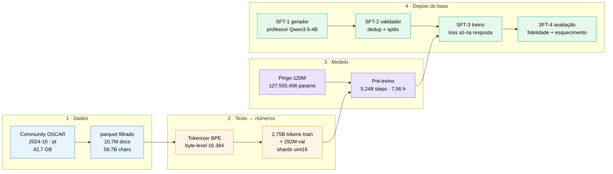

# 🐦 Pingo — o vault

**Uma LLM em português, construída do zero.** Este vault é a documentação completa do projeto:
cada etapa, do download do Common Crawl até a resposta do modelo afinado — com os números
reais medidos, as fórmulas, os diagramas e (principalmente) os erros que aprendemos no caminho.

> [!tip] Como navegar
> Este arquivo é a **home** do vault (no Obsidian: *"Use as a starting note"* apontando para
> `Pingo.md`). Cada nota tem links no rodapé e no corpo: use o grafo e o backlink para seguir o
> fio. As notas estão agrupadas **na ordem em que o projeto foi executado** — que é a ordem em
> que faz sentido ler.

---

## O projeto em uma tela

---

## Painel de números (o que foi medido de verdade)

| Métrica | Valor | Onde |
|---|---|---|
| Docs brutos lidos do dump | 19.321.760 | [[Filtro de qualidade]] |
| Docs aprovados | 10.739.158 (55,6%) | [[Filtro de qualidade]] |
| Caracteres de treino | 59.737.711.111 (~15B tokens potenciais) | [[Filtro de qualidade]] |
| Vocabulário BPE | 16.384 (+3 no SFT = 16.387) | [[Tokenizer BPE byte-level]] |
| Compressão no val | **4,091 chars/token** (GPT-2: 2,687 → −34,3%) | [[Métricas de compressão]] |
| Tokens de treino binarizados | 2.751.379.389 | [[Binarização e shards]] |
| Parâmetros do modelo | **127.555.456** | [[Contagem de parâmetros]] |
| Pré-treino | 5.248 steps · 2,75B tokens · 7,56 h · ~101k tok/s | [[Run do Pingo-120M]] |
| Val loss final | 2,507 → **ppl 12,3** (treino) / 2,4571 → **ppl 11,67** (avaliação) | [[Perplexidade e KV cache]] |
| KV cache em serving | 5,8× (ctx 512) · **10,6×** (1024) · **11,8×** (2016), B=16 | [[KV cache]] |
| Pares de SFT gerados | 30.000 (meta) · ~40 pares/min no professor local | [[Geração do dataset]] |
| Custo da comparação de professores | US$ 0,07 (OpenRouter, 3 modelos × 60 trechos) | [[Professores remotos (OpenRouter)]] |

---

## Mapa de todas as notas

### 00 — O projeto
- [[Visão e filosofia]] — o que é o Pingo, o que **não** é, e as escolhas de fundo
- [[Linha do tempo]] — a história real, commit por commit (27 commits, 2 dias)
- [[Decisões (ADR)]] — cada decisão com data, alternativas e o porquê
- [[Infra e GPU]] — uv, as duas máquinas, VRAM/RAM/disco, o servidor Strata

### 01 — Dados
- [[Escolha do dataset]] — por que Community OSCAR, por que o dump `2024-10`, o que descartamos
- [[Download do OSCAR]] — download retomável, orçamento, `HfApi`, `.part` + Range
- [[Filtro de qualidade]] — os quatro filtros do pré-treino, dedup, split 98/2 e os números

### 02 — Tokenizer
- [[Tokenizer BPE byte-level]] — BPE na unha, byte fallback, regex GPT-2, por que 16k
- [[Métricas de compressão]] — como medimos chars/token e o que o resultado significa

### 03 — Tokens
- [[Binarização e shards]] — uint16, shards de 1M, memmap, `get_batch` e o shift do alvo

### 04 — Arquitetura
- [[Arquitetura do Pingo]] — o todo: blocos, fluxo de tensor, shapes
- [[RMSNorm]] — normalização sem média, estatística em fp32
- [[RoPE]] — rotação posicional, `inv_freq` sob demanda, invariância relativa
- [[Atenção causal]] — MHA com SDPA, máscaras (causal × padding)
- [[SwiGLU]] — o MLP com portão
- [[Inicialização e embeddings tied]] — normal 0,02, escala 1/√(2L), embedding compartilhado
- [[Contagem de parâmetros]] — a conta fechando 127.555.456
- [[KV cache]] — buffers pré-alocados, prefill × decode, e o ganho real
- [[Geração (sampling)]] — greedy, temperatura, top-k, top-p, repetition penalty

### 05 — Pré-treino
- [[Loop de treino]] — AdamW com grupos de decay, warmup+cosine, accum, bf16, clip
- [[Checkpoints e resume]] — atomicidade, RNGs, `ckpt-prev.pt`, resume bit-exato
- [[Run do Pingo-120M]] — a curva real de val loss, passo a passo
- [[Benchmarks na GPU]] — tok/s, VRAM, `torch.compile`, o que cabe e o que não cabe

### 06 — Avaliação do base
- [[Perplexidade e KV cache]] — ppl 11,67, bits/token, amostras, benchmark do cache

### 07 — SFT (instruction tuning)
- [[Por que SFT]] — a mudança de rumo de 2026-10-30 (350M suspenso)
- [[O professor local]] — llama.cpp, 8 slots, JSON estrito, por que o thinking é o inimigo
- [[Geração do dataset]] — filtro duro, chunking, prompt v2, veto, validação, tetos
- [[Formato do exemplo]] — o JSONL real, campo por campo
- [[Validação, dedup e splits]] — MinHash/LSH na unha, split por documento
- [[Juiz de recusas]] — a única classe que precisa de segunda opinião
- [[Treino SFT]] — tokens de chat, `labels` deslocados, `attention_mask`, resize do embedding
- [[Avaliação SFT]] — formato, F1, fidelidade, esquecimento catastrófico
- [[Professores remotos (OpenRouter)]] — a comparação medida de 3 modelos, com preços

### 08 — Qualidade
- [[Suíte de testes]] — 103 testes, e o que cada um protege

### 09 — Referência
- [[Glossário]] — todo jargão que aparece no vault
- [[Comandos e cheatsheet]] — a sequência exata de comandos por etapa
- [[Gotchas]] — a lista completa de pegadinhas (a nota mais útil do vault)

---

## Estado do projeto (2026-10-30)

```mermaid
flowchart LR
    s1["1 setup"] --> s2["2 dados"] --> s3["3 tokenizer"] --> s4["4 tokens"] --> s5["5 modelo"]
    s5 --> s6["6 pré-treino"] --> s7["7 avaliação"]
    s7 --> s1g["SFT-1 gerador"]
    s1g --> s2v["SFT-2 validador"] --> s3t["SFT-3 treino"] --> s4e["SFT-4 avaliação"]
    s4e -.-> s8["8 · escalar p/ 350M<br/>suspenso"]
    style s1 fill:#c7f9cc,stroke:#2f9e44
    style s2 fill:#c7f9cc,stroke:#2f9e44
    style s3 fill:#c7f9cc,stroke:#2f9e44
    style s4 fill:#c7f9cc,stroke:#2f9e44
    style s5 fill:#c7f9cc,stroke:#2f9e44
    style s6 fill:#c7f9cc,stroke:#2f9e44
    style s7 fill:#c7f9cc,stroke:#2f9e44
    style s1g fill:#fff3bf,stroke:#f08c00
    style s2v fill:#c7f9cc,stroke:#2f9e44
    style s3t fill:#e9ecef,stroke:#868e96,stroke-dasharray: 5 5
    style s4e fill:#e9ecef,stroke:#868e96,stroke-dasharray: 5 5
    style s8 fill:#ffe3e3,stroke:#c92a2a,stroke-dasharray: 5 5
```

- ✅ **Fase 1 concluída**: Pingo-120M pré-treinado, avaliado, com backup *read-only* em
  `runs/pt-120m-BACKUP-2026-10-30/`.
- 🔄 **Gerando o dataset de SFT** (`data/sft/sft-v1.jsonl`, meta 30.000 pares, ~22% em
  2026-10-30 15h). O gerador é retomável: `--resume`.
- ⬜ Falta: validar → treinar o SFT → avaliar.

> [!warning] Regra de ouro do repositório
> `AGENTS.md` é o estado vivo (handoff entre sessões); **este vault** é a documentação
> explicativa de como cada coisa foi feita e por quê. Se os dois divergirem nos números,
> o `AGENTS.md` ganha — e este vault deve ser corrigido.
